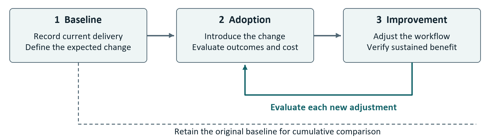
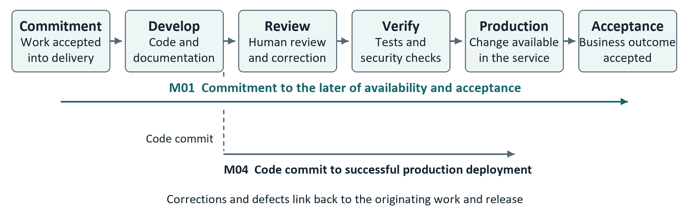
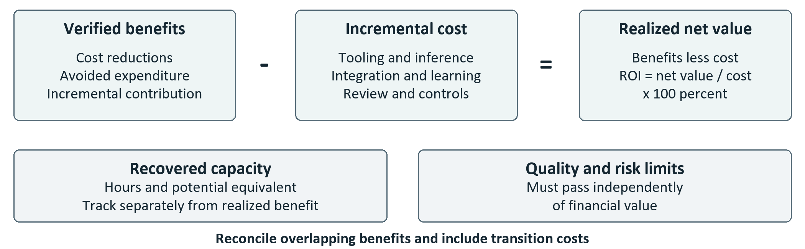
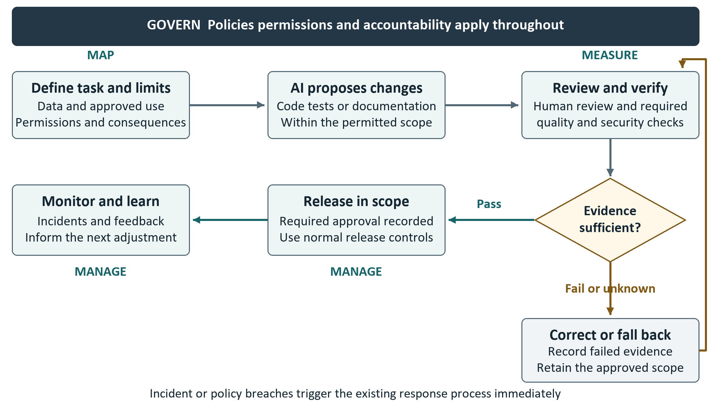

**PolarSpark LLC**

BUSINESS WHITE PAPER

# Engineering Impact Framework

Measuring the value of AI and software delivery changes

**Paul Harding, MBA ITM**

PolarSpark LLC  |  [https://polarspark.com/](https://polarspark.com/)

Version 1.3  |  23 November 2026

A change to engineering practice should earn its place through measurable delivery outcomes, acceptable risk, and value that can be verified. This white paper provides the decision model and evidence records for evaluating AI tools, changes to existing AI use, and new development workflows in real delivery.

The framework combines sprint observations with production, business, and stakeholder evidence. It keeps recovered engineering capacity separate from realized financial benefits and assesses SDLC practice, documentation, and AI adoption as distinct maturity profiles.

**Baseline** records current delivery. **Adoption** evaluates the introduced change. **Improvement** tests an adjustment against both the original baseline and the preceding state.

**Intended readers** Engineering leaders, product owners, security and platform teams, finance partners, and business sponsors.

**Contents**

[Executive summary	3]()

[Framework structure and operating rules	4]()

[Phase 1 Baseline current delivery	4]()

[Phase 2 Adoption and evaluation	5]()

[Phase 3 Improvement and adjustment	6]()

[Ownership and sprint cadence	7]()

[Evidence model and data handling	7]()

[Comparison and calculation rules	9]()

[Primary outcome metric definitions	10]()

[Production delivery metric definitions	10]()

[Production stability and observation rules	11]()

[Workflow diagnostic metric definitions	12]()

[Quality and security metric definitions	13]()

[Experience and adoption metric definitions	14]()

[Business and documentation metric definitions	15]()

[AI risk and operational metric definitions	16]()

[Value calculations and recognition rules	18]()

[Worked adoption value example	19]()

[Value ledger and sensitivity	20]()

[Maturity scoring method	21]()

[SDLC maturity profile	22]()

[Documentation maturity profile	22]()

[AI adoption maturity profile	23]()

[NIST AI adoption integration	25]()

[AI risk evaluation and adoption decisions	26]()

[AI review and release workflow	27]()

[Implementation and reporting plan	28]()

[Framework version and adoption notes	28]()

[References and source notes	30]()

## Executive summary

The Engineering Impact Framework (EIF) measures whether a change to software development practices improves delivery and produces value worth its total cost. It covers first adoption of AI, changes to existing AI tools, and new engineering workflow patterns. Teams apply it to normal operational delivery and feature work.

We assess a team delivering an application or service. Agile sprints provide the inspection cadence. Production releases, business acceptance, customer outcomes, and later defects provide evidence that may arrive after the sprint ends.

The relationship is illustrated in figure 1.

Fig. 1. Baseline establishes the reference point while Adoption and Improvement form a repeated evaluation loop. Original framework diagram.

### Decisions this framework supports

- Establish whether the current workflow can be measured and where improvement would matter.

- Determine whether an adoption should expand, continue under observation, change, or stop.

- Confirm that benefits persist and that quality, security, and stakeholder experience remain acceptable.

### How to use the documents

Use this document for definitions, calculations, scoring, governance, and interpretation. Copy the forms in the companion Engineering Impact Framework Workbook document for each initiative and sprint. Every measure uses an identifier that remains consistent across both documents.

Start with three primary measures: time to accepted production value, delivery effort or cost, and realized net adoption value. Add the diagnostics needed to explain the proposed change and its risks. Do not make every metric a target.

### Scope and interpretation

Measurement rules, scoring, suggested observation windows, and decision thresholds are proposed organizational conventions. Tailor them to local ownership, evidence, and risk policies. All worked results are illustrative. Alignment with a cited standard does not establish certification or regulatory compliance.

The phases, metric extensions, value calculations, maturity scores, templates, and diagrams are PolarSpark framework designs. ISO references use public descriptions and abstracts. This white paper does not establish conformity or certification.

## Framework structure and operating rules

**Table 1. Framework Components and Their Purpose**

| **Part** | **What it establishes** |
| --- | --- |
| Operating model | Three phases, roles, sprint cadence, and adoption contract |
| Measurement | Evidence, comparable work, metric definitions, and attribution |
| Value | Capacity, financial benefits, total costs, and sensitivity |
| Maturity | Separate SDLC, documentation, and AI adoption profiles |
| NIST integration | AI risk responsibilities and evidence across all phases |
| Templates | Reusable records provided in the companion document |

### Rules that apply throughout

- Measure team systems and application outcomes. Do not use lines of code, prompt counts, commits, or story points as individual productivity ratings.

- Keep speed, value, and risk visible separately. A financial benefit cannot offset an unacceptable security condition.

- Define eligible work, comparison groups, cost boundaries, and thresholds before evaluating results. Record all changes to those definitions.

- Preserve the original baseline. When a new adjustment begins, retain both the original baseline and the preceding operating state.

- Record actual use and unknown exposure. A license, an installed extension, or a generated suggestion does not establish useful adoption.

- Make missing data visible. Do not replace unknown results with zero or label unmeasured risk as acceptable.

The design draws on lifecycle standards [1, 2], DORA delivery research [3], SPACE productivity research [4], Scrum [5], and NIST guidance [6, 7, 8, 9, 10]. The references section identifies these references. Detailed controls and legal obligations must be mapped to the organization separately.

## Phase 1 Baseline current delivery

Phase 1 establishes how work is delivered today and what the proposed change should improve. For an organization already using AI, the baseline includes that usage. The intervention is the incremental change from the recorded current state.

### Required activities

1. Choose the application, accountable team, business outcome, and workflow stage. Map commitment, development, review, testing, security, production availability, and acceptance.

1. Record existing AI products, versions where available, approved uses, data handling, permissions, and human review. Record other automation and planned process changes.

1. Collect representative historical data and prospective feedback. A starting window is four to six complete sprints, extended for low volumes, seasonality, or atypical operations.

1. Assess the SDLC, documentation, and AI adoption maturity profiles. Capture evidence and gaps rather than relying only on workshop opinions.

1. Define the adoption hypothesis, three primary measures, selected diagnostics, quality and security limits, costs, comparison method, and observation windows.

### Required evidence

Retain the adoption contract T01, metric definitions T02, baseline sprint records T03, stakeholder feedback T06, maturity assessment T09, and applicable AI risk records T10. Separate incomplete records and unavailable fields from measured results.

### Exit decision

The delivery owner confirms that the workflow and scope are defined. Metric owners confirm usable evidence or explicit limitations. The product owner confirms the desired outcome. Security and the AI risk owner confirm that the proposed use fits the agreed risk tolerance. Unresolved critical controls prevent expansion into the affected use.

A reconstructed baseline may be used when history is incomplete, with its limitations recorded. If there is no defensible baseline or comparison, report the current state and begin prospective collection before claiming improvement.

## Phase 2 Adoption and evaluation

Phase 2 measures the change in real delivery. Start with a staged rollout where feasible, using comparable teams or workstreams and an explicit allocation rule. A staged rollout can operate in production while retaining normal release and security controls.

### Required activities

1. Record activation dates, eligible work, exposure, training, vendor configuration, and changes in permissions. Distinguish assigned access, actual use, and evaluated output.

1. Identify the learning period in advance. Include its costs in the investment view and report its delivery results separately from steady operation. Do not remove poor results after observing them.

1. Collect sprint measures and role-specific feedback. Include review, QA, security, operations, and documentation effort so a local speedup cannot conceal transferred work.

1. Compare with baseline and the comparison group where available. Track work mix, available capacity, incidents, release constraints, and simultaneous changes.

1. Evaluate at the agreed checkpoint, initially after four to six post-change sprints. Extend observation for insufficient volume, unstable operation, or delayed outcomes.

### Required evidence

Use T04 for each adoption sprint, T07 for stakeholder feedback, T11 for costs and benefits, and T12 for the evaluation decision. Update the AI risk register and record any tool or model change that could affect the result.

### Decision options

**Table 2. Adoption Evaluation Decisions**

| **Decision** | **Evidence and response** |
| --- | --- |
| Expand | Benefits meet the agreed practical threshold and applicable controls and guardrails pass. Name the next scope. |
| Continue observing | Evidence is incomplete or too variable. Name the missing evidence, next checkpoint, and permitted scope. |
| Adjust | A specific workflow or control problem has a testable correction. Create a versioned adjustment. |
| Discontinue or restrict | Costs exceed the justified benefit, outcomes deteriorate, or unacceptable risk persists. Execute the fallback plan. |

## Phase 3 Improvement and adjustment

Phase 3 tests whether improvements can be sustained and extended. Treat each meaningful change as a versioned intervention, including model upgrades, prompt or context changes, permission changes, and new workflow patterns.

### Required activities

1. Select a bottleneck supported by evidence. For example, faster coding may expose slow review or weak test reliability.

1. Record the adjustment, expected effect, affected risks, cost, and rollback condition. Change one major element at a time when practical.

1. Compare the adjusted state with both the original baseline and the preceding adopted state. This distinguishes cumulative value from the marginal value of the adjustment.

1. Repeat relevant AI evaluations and production monitoring when behavior, scope, data access, or versions change. Verify that previous benefits and controls still hold.

1. Update documentation, learning materials, ownership, and the improvement backlog. Reassess maturity at a meaningful release or quarterly checkpoint, rather than forcing a new score every sprint.

### Required evidence

Use adjustment scorecard T05 and feedback T08. Carry forward T09-T12 for maturity, AI risk, value, and decisions. Preserve prior decisions and source snapshots so cumulative claims remain reproducible.

### Sustainability review

Look for benefit erosion, review fatigue, supplier dependency, rising inference cost, knowledge loss, and deferred maintenance. Check whether new hires and less experienced engineers can understand and support the resulting code.

An adjustment is complete when its agreed outcomes have been observed for the stated window, controls have passed, and ongoing ownership is assigned. Financial and customer outcomes that have not matured remain pending. Completion of implementation alone does not establish benefit realization.

## Ownership and sprint cadence

**Table 3. Accountabilities and Evidence Ownership**

| **Accountability** | **Responsible role** | **Decision or evidence** |
| --- | --- | --- |
| Initiative | Engineering or delivery lead | Scope, intervention version, execution, and fallback |
| Business outcome | Product owner or business sponsor | Acceptance, outcome target, and business benefit |
| Measurement | Named metric or analytics owner | Definitions, joins, completeness, and calculations |
| Security and AI risk | Security lead and designated AI risk owner | Risk tolerance, testing, exceptions, and escalation |
| Value verification | Finance or delegated benefit owner | Cost boundaries, attribution, and realized benefits |
| Operational quality | QA and operations owners | Release quality, reliability, and downstream burden |
| Documentation | Service or knowledge owner | Required artifacts, accuracy, and maintenance |

### Use existing ceremonies

At Sprint Planning, identify the intervention version and expected work mix. Confirm the Sprint Goal and relevant Definition of Done. During the sprint, gather delivery events and respond immediately to risk breaches. Avoid daily individual productivity reporting.

At the Sprint Review, inspect delivered and accepted outcomes with business stakeholders. At the Retrospective, examine bottlenecks, effort transfer, and developer feedback. Close the scorecard after the data cutoff and name any pending observations.

At each evaluation checkpoint, the accountable owners decide whether to expand, observe, adjust, or stop. Keep a decision record with the evidence, dissent, conditions, and next review date. These activities extend local measurement practice and are not additional Scrum requirements [5].

### Tailor thresholds before use

Set improvement thresholds from baseline variation, business importance, available volume, and cost. Set security and operational limits from existing policy and service objectives. Record both practical significance and evidence sufficiency. A target such as a 15 percent reduction in lead time is illustrative until locally justified.

## Evidence model and data handling

Link work to delivery and outcomes using stable identifiers. Store raw evidence in its governed source and retain reproducible references or snapshots. Use a separate measurement layer for aggregation.

The relationship is illustrated in figure 2.

Fig. 2. Illustrative delivery path and measurement points for M01 and M04. Actual workflows may iterate and acceptance may precede production. Original measurement diagram; the commit to production concept follows DORA [3].

**Table 4. Minimum Evidence Records**

| **Record** | **Minimum fields** |
| --- | --- |
| Adoption | Initiative ID, version, hypothesis, phase, scope, dates, owner, tool and known model version |
| Work item | Work ID, service, work class and risk class, commitment time, sprint, acceptance criteria |
| Delivery | PR and commit IDs, review and test events, deployment ID, environment, availability time |
| Outcome | Acceptance time, defect or incident ID, severity, affected release, business outcome ID |
| Exposure | Work ID or team window, assigned rollout group, actual use yes no or unknown, source |
| Value | Ledger ID, period, category, quantity, rate, allocation, evidence, verifier, overlap key |
| Feedback | Phase, role, sprint, question version, response, eligible count, response count |
| Risk | AI use case, data classes, privileges, evaluations, owner, treatment, residual risk |

### Joining and reconciliation

Allow many work items per PR and many PRs per deployment without multiplying deployment counts or costs. Count deployments once per defined service and environment. Allocate shared effort and costs once using a recorded rule. Track unmatched records and delayed evidence.

### Privacy and collection

Collect the minimum telemetry needed. Prefer event metadata over raw prompts, source code, or customer data. Apply existing access, retention, and classification rules. Keep respondent identities out of team scorecards. Use a locally approved minimum reporting group, for example five respondents, and combine or suppress smaller groups.

This framework does not require keystroke capture, screen recording, or continuous individual time tracking. Sampled effort diaries or existing task records may support effort estimates if collection burden and uncertainty are reported.

## Comparison and calculation rules

### Define the population

Choose work classes and risk or complexity bands before analysis. Keep feature work, maintenance, incidents, and security remediation identifiable. Compare like work within the same application context. Report available team capacity and changes in scope. Story points remain a local planning tool and must not be converted into cross-team productivity or financial value.

### Use consistent time boundaries

Store timestamps in UTC and display a named reporting timezone. A reporting window includes events at its start and excludes events at its end. Use elapsed calendar time for delivery measures unless a business-hours variant is explicitly labeled. Report complete sprints and state the extraction cutoff.

For durations, report the median and 85th percentile of underlying item durations. Use one documented quantile method, such as linear interpolation at position one plus the percentile times the count minus one. Never average sprint percentiles. For rates, sum numerators and denominators across the window before dividing.

### Retain unfinished and delayed outcomes

Completion-based metrics can hide stalled work. Report age and count of unfinished work alongside completion times. Define a follow-up window for defects and acceptance, initially 30 days where suitable. Mark recent cohorts provisional until their full follow-up ends. Use the same follow-up for baseline and post-change cohorts.

### Interpret change

For a lower-is-better metric, percent improvement is baseline minus post-change, divided by baseline, multiplied by 100. For higher-is-better measures, reverse the subtraction. When baseline is zero, report absolute change and mark relative change undefined. For percentages, show percentage-point change as well as endpoints.

Prefer staged allocation or a credible comparison group. An adjusted change is the adopting group change minus the comparison group change in the same units. Check earlier trends and concurrent differences. This method supports attribution only when its assumptions are credible; it does not remove all confounding.

Record counts, variation, exclusions, work mix, and uncertainty. Use suitable intervals or analyst review when volume permits. Avoid claims of statistical certainty from a few sprints or rare incidents. Without a defensible causal design, describe the finding as an association.

## Primary outcome metric definitions

The catalogue defines standard starting measures. Select diagnostics that can change a decision. Unless stated otherwise, calculate per application for each complete sprint and the agreed rolling evaluation window. Record the metric version, sample size, exclusions, and evidence cutoff in T02.

### M01 Time to accepted production value

**Definition and calculation.** For each eligible work item, measure calendar days from recorded commitment to the later of production availability and business acceptance. Report median and 85th percentile. Also report commitment to availability and availability to acceptance separately.

**Source and accountability.** Work tracker, deployment records, and product acceptance record. Owner: delivery lead with product owner. Report completed items and unfinished item age using M11.

**Interpretation and action.** Lower is generally better for comparable work. Keep acceptance rules stable. Administrative acceptance delays must remain visible. Commit-to-production lead time is separately defined as M04.

### M02 Delivery effort and cost per outcome

**Definition and calculation.** Sum attributable person-hours for development, review, QA, security, documentation, operations, and corrective work. Divide by comparable accepted production outcomes. Report hours per outcome. Cost per outcome uses documented loaded rates plus allocated non-labor delivery costs.

**Source and accountability.** Task effort records or a disclosed sample, payroll or finance rate assumptions, and delivery IDs. Owner: engineering lead with finance. Reconcile work cohorts and follow-up periods.

**Interpretation and action.** Lower is better when scope and quality remain comparable. Include effort spent on abandoned work in period totals. Separate one-time adoption cost. Do not treat elapsed time reductions as equivalent labor savings.

### M03 Realized net adoption value

**Definition and calculation.** Over a stated period and cost basis, subtract incremental adoption costs from verified incremental financial benefits. Report currency, gross benefit, total cost, net value, and realized ROI. Show cumulative results including transition cost.

**Source and accountability.** T11 benefit and cost ledger, financial evidence, business outcome records, and named verification. Owner: finance or delegated benefit owner.

**Interpretation and action.** Positive value supports investment when risk limits pass. Recovered capacity and modeled risk reduction remain separate until realized. Negative or unavailable value is reported directly. Calculation rules and examples follow the catalogue.

## Production delivery metric definitions

M04-M08 use the five DORA metric concepts [3]. The cohort and counting rules below are local operational definitions. Freeze them before comparison. Use production deployments of a named service; remove non-production runs and duplicate pipeline events.

### M04 Change lead time

**Definition and calculation.** For each included commit, elapsed hours from version-control commit timestamp to its first successful production deployment. Report median and 85th percentile. Document handling of squash commits, cherry-picks, and migrated history.

**Source and accountability.** Version control and deployment manifest. Owner: delivery platform owner. Keep source-to-artifact links and excluded or unmatched commit counts.

**Interpretation and action.** Lower can indicate faster delivery. Report unshipped changes separately. Large and small commits differ, so inspect work mix and review burden. This begins later than the commitment-based M01.

### M05 Deployment frequency

**Definition and calculation.** Count distinct deployments that make a production service version available during the window, divided by calendar days or weeks in that window. State the unit. Count one logical rollout once across its replicas.

**Source and accountability.** Production release records and artifact IDs. Owner: release or platform owner. State treatment of configuration-only changes and rollback deployments.

**Interpretation and action.** More frequent delivery can be useful, but deployment count is not customer value. Pair with stability and acceptance. Do not require an arbitrary deployment target for every service.

### M06 Failed deployment recovery time

**Definition and calculation.** Elapsed hours from the failed production deployment or its failure onset, using a fixed documented convention, until recovery is verified. Report median, 85th percentile, count, and unresolved failures. Prefer the actual failure onset when known.

**Source and accountability.** Deployment and incident timelines with service recovery evidence. Owner: operations lead. Retain the selected start convention and missing timestamps.

**Interpretation and action.** Lower is better. Report no observed failed deployments as no sample, not zero-hour recovery. This measure covers deployment failures, rather than all incident recovery.

## Production stability and observation rules

### M07 Change fail rate

**Definition and calculation.** Distinct production deployments that cause a failure requiring immediate intervention divided by all included production deployments, multiplied by 100. Retain the failure severity and parent deployment link.

**Source and accountability.** Release and incident records. Owner: operations with QA. Use a declared failure attribution window and consistent operational criteria.

**Interpretation and action.** Lower is better. Report numerator and denominator. One deployment counts once even if it causes multiple incidents. Also inspect severe incidents independently of the rate.

### M08 Deployment rework rate

**Definition and calculation.** Unplanned production deployments performed to correct production defects or incidents divided by all included production deployments, multiplied by 100. Apply a fixed classification at review.

**Source and accountability.** Release purpose, incident or defect references, and deployment ID. Owner: release lead. Distinguish corrective deployments from planned enhancements.

**Interpretation and action.** Lower is generally better. A corrective deployment may itself fail, so M07 and M08 overlap and must not be added. Rework outside production deployment is captured in M13.

### Apply the same follow up

Assign failures to their originating deployment cohort even when detected after sprint close. State the follow-up window and publish revisions when late evidence arrives. Keep recent cohorts provisional. A separate operational incident view may report incidents by detection date, but it must not be substituted for the deployment cohort rate.

### Example of aggregation

If one sprint has one failed deployment out of ten and the next has one out of two, the combined rate is two out of twelve, or 16.7 percent. Averaging 10 percent and 50 percent would produce an incorrect 30 percent combined rate.

The five delivery metrics are interpreted together for a service. They support improvement discussions and should not be blended into a universal ranking of unrelated teams [3].

## Workflow diagnostic metric definitions

### M09 Review waiting time

**Definition and calculation.** For each review cycle, elapsed hours from ready-for-review to the first substantive human response. Sum waiting intervals per PR or report cycle distributions consistently. Exclude explicitly marked author draft time.

**Source and accountability.** PR state and review events. Owner: engineering lead. Record bot responses separately and retain draft transitions.

**Interpretation and action.** Lower is useful if review quality holds. A quick acknowledgement alone is not substantive review. Check whether AI adoption increases the number or complexity of review cycles.

### M10 Blocked work time

**Definition and calculation.** Hours in explicitly recorded blocked status divided by hours from work start to completion or current cutoff, multiplied by 100. Use the same elapsed or business-hours basis for both terms.

**Source and accountability.** Work tracker transitions and blocker categories. Owner: delivery lead. Validate consistent use of blocked status.

**Interpretation and action.** Lower is better when reporting behavior is stable. Break down environment, dependency, knowledge, and approval blockers. Missing blocker tagging limits the result.

### M11 Unfinished work age and carryover

**Definition and calculation.** For open committed items, report count and median and 85th-percentile age from commitment to cutoff. Carryover is unfinished items from the original sprint commitment divided by items committed at sprint start.

**Source and accountability.** Sprint snapshots and current work status. Owner: delivery lead. Report added, removed, and canceled items separately.

**Interpretation and action.** Lower age and carryover can indicate healthier flow. They also depend on work size and priority changes. Keep original commitments intact rather than rewriting the denominator.

### M12 Build and test feedback time

**Definition and calculation.** Elapsed minutes from an eligible CI run being queued to actionable build and test results. Report median, 85th percentile, queue time, and run time. Separate PR validation from release pipelines.

**Source and accountability.** CI timestamps and run categories. Owner: platform or QA lead. Include failed and canceled runs in their appropriate categories.

**Interpretation and action.** Lower is better if checks remain effective. Track flaky tests and bypassed checks. Do not obtain a faster result by silently removing required validation.

## Quality and security metric definitions

### M13 Corrective effort share

**Definition and calculation.** Person-hours correcting defects in previously delivered work divided by total recorded delivery person-hours in the same period, multiplied by 100. Split pre-production and production correction and avoid duplicate time entries.

**Source and accountability.** Effort records linked to defect IDs. Owner: QA with engineering. Retain original delivery cohort where identifiable.

**Interpretation and action.** Lower is better under stable detection. Report sampled coverage. Keep AI output correction identifiable so review or test effort is not mistaken for a net saving.

### M14 Escaped defects

**Definition and calculation.** Confirmed production defects detected within the declared follow-up per 100 delivered outcomes, grouped by severity. Also report absolute severe-defect counts. Use equal follow-up across cohorts.

**Source and accountability.** Defect and incident records linked to delivered outcomes. Owner: QA. De-duplicate related reports and document severity changes.

**Interpretation and action.** Lower is better. More testing or reporting can increase detected defects without worsening code. Pair with test coverage and customer impact. Recent releases remain provisional.

### M15 Vulnerability remediation and exposure

**Definition and calculation.** Report open vulnerability count, median and 85th-percentile age, and overdue count by severity at cutoff. For resolved findings, report time from validated detection to verified remediation. Keep accepted exceptions separate.

**Source and accountability.** Security finding system, asset inventory, and remediation evidence. Owner: security lead. Use stable finding identities across repeated scans.

**Interpretation and action.** Lower exposure and faster remediation are desirable. Never average away a critical finding. Report changes in scan coverage. A waived issue is not a remediated issue.

### M16 Required control execution

**Definition and calculation.** Eligible changes with all applicable required control results present divided by eligible changes, multiplied by 100. Report failures, bypasses, and approved exceptions separately from execution.

**Source and accountability.** CI policy results, security checks, and release approvals. Owner: security with platform. Freeze the applicability rules.

**Interpretation and action.** Higher execution is desirable, but execution alone does not establish effectiveness. Missing results are incomplete evidence. Use SSDF to organize local secure development expectations [9].

## Experience and adoption metric definitions

### M17 Developer experience pulse

**Definition and calculation.** Report the distribution and median for each stable five-point feedback question, plus favorable responses of four or five divided by valid responses. Report response count and eligible count; exclude not-applicable answers.

**Source and accountability.** T06-T08 surveys. Owner: engineering enablement or research owner. Protect respondent identity and retain question versions.

**Interpretation and action.** Use individual questions for toil, cognitive burden, review, and collaboration. Do not conceal a worsening item in a composite average. Perceived time savings need independent validation.

### M18 AI exposure and adoption

**Definition and calculation.** Work exposure is eligible work items with documented AI use divided by all eligible items. Separately report unknown exposure share, access allocation, and active eligible users under a declared usage definition.

**Source and accountability.** Approved tool metadata or structured work tags. Owner: enablement lead. Record assignment to rollout groups separately from actual use.

**Interpretation and action.** Adoption is a diagnostic, not proof of value. Changes in eligibility alter the denominator. Do not compare voluntary users with nonusers as if assignment were random.

### M19 AI output evaluation results

**Definition and calculation.** Reviewed AI-assisted outputs meeting the declared acceptance rubric divided by reviewed AI-assisted outputs. Report first-review results and final results separately, with rejection and correction reasons.

**Source and accountability.** Structured review sample and task IDs. Owner: engineering or QA. Record sampling method, sample count, rubric, and evaluator.

**Interpretation and action.** A higher pass rate may indicate suitability, but easy samples can inflate it. IDE suggestion acceptance is a different vendor measure. Generated tests must be checked for meaningful assertions.

### M20 Net task effort change

**Definition and calculation.** Compare total person-hours per comparable task before and after the change, including prompting, verification, review, tests, correction, and documentation. Report absolute hours and relative change.

**Source and accountability.** A declared effort sample or reliable task records. Owner: engineering with measurement owner. Record work class and number sampled.

**Interpretation and action.** A positive saving can support a capacity estimate. Do not multiply an unrepresentative sample across all engineering work. Keep one-time training in the investment ledger.

## Business and documentation metric definitions

### M21 Sprint Goal and acceptance results

**Definition and calculation.** Record Sprint Goal achieved yes, partial, or no with product-owner rationale. Separately report accepted delivered outcomes divided by outcomes submitted for acceptance, using a declared follow-up window.

**Source and accountability.** Sprint Goal record and acceptance decisions. Owner: product owner. Retain scope changes and acceptance reasons.

**Interpretation and action.** Interpret the goal record qualitatively and report acceptance numerators. Avoid inventing a numerical value for partial achievement. Ticket count alone does not establish business value.

### M22 Customer or business outcome

**Definition and calculation.** Choose one outcome tied to the initiative, such as successful eligible customer tasks divided by attempted tasks, adoption among eligible customers, or support cases per 100 active accounts. Freeze the event and denominator definitions.

**Source and accountability.** Product analytics, support records, or the authoritative business system. Owner: product or business owner. Use T02 to specify the chosen outcome and attribution method.

**Interpretation and action.** Direction depends on the outcome. Segment by relevant customer groups and account for release exposure and seasonality. Customer-visible impact may lag sprint completion.

### M23 Verified documentation coverage

**Definition and calculation.** Required information items that are present, owned, version-linked, and reviewed within their local validity period divided by all applicable required information items, multiplied by 100.

**Source and accountability.** Documentation inventory with evidence links and review dates. Owner: service documentation owner. Approve and explain not-applicable exclusions.

**Interpretation and action.** Higher coverage supports readiness. Coverage does not prove correctness. Validate representative content, including requirements, architecture, tests, threats, and recovery guidance.

### M24 Documentation task success

**Definition and calculation.** Sampled knowledge tasks completed correctly using maintained documentation within the declared limit divided by attempted sampled tasks. Report time distribution and task class as well as pass rate.

**Source and accountability.** Onboarding, support, or runbook exercises. Owner: documentation with operations. Preserve task scripts and evaluator notes.

**Interpretation and action.** Higher success and shorter comparable task times indicate usefulness. Examples include locating a design decision or following a recovery procedure. Keep test tasks representative.

## AI risk and operational metric definitions

These are proposed measures for the local AI use case, informed by NIST AI RMF and its generative AI profile [6, 7, 8]. Their thresholds are organizational choices. They are not official NIST adoption scores.

### M25 AI evaluation pass rate

**Definition and calculation.** Test cases meeting their predefined criteria divided by valid executed cases, by task and risk category. Report critical failures individually, excluded cases, repeated trials, and unresolved failures.

**Source and accountability.** Versioned evaluation set, model and tool configuration, permissions, and evaluator. Owner: AI risk with QA. Separate development cases from held-out cases.

**Interpretation and action.** Higher can support a decision only for tested conditions. Evaluate unreliable output, data handling, malicious context, and unsafe actions where applicable. Re-test relevant cases after material changes.

### M26 Human oversight coverage

**Definition and calculation.** AI-assisted changes or actions requiring human approval with evidenced approval before execution divided by all AI-assisted changes or actions requiring approval. Report unapproved execution count separately.

**Source and accountability.** PR approvals, release controls, agent action logs, and exposure records. Owner: engineering with AI risk. Scope depends on privilege and consequence.

**Interpretation and action.** Required oversight should be complete. Approval presence does not establish adequate review. Sample reviewer understanding and test evidence. Unknown AI exposure limits coverage claims.

### M27 AI incidents and near misses

**Definition and calculation.** Count confirmed incidents and credible near misses by severity, use case, and cause during the period. Track time to containment and unresolved items. Use an exposure-normalized rate only when the exposure denominator is reliable.

**Source and accountability.** Incident system and reporting channel. Owner: security or AI incident lead. Separate confirmed AI contribution from suspected contribution.

**Interpretation and action.** Any material harm triggers review under local policy. Zero reports do not prove zero risk. Keep reporting willingness and detection coverage visible.

### M28 AI availability and unit cost

**Definition and calculation.** Report successful approved tool requests divided by valid requests, latency percentiles, and incremental tool cost per comparable accepted outcome. Include subscriptions, inference, platform, and support allocations.

**Source and accountability.** Approved provider usage, invoices, and platform telemetry. Owner: platform with finance. Record retries, failures, and shared-cost allocation.

**Interpretation and action.** Interpret reliability and cost with delivered quality. Token counts explain consumption but do not measure value. Test the fallback when the provider is unavailable or behavior changes.

## Value calculations and recognition rules

Maintain three separate benefit views. The financial view recognizes verified incremental benefits. The capacity view reports effort released for other work. The strategic and risk view records outcomes that cannot yet be valued credibly. Never add these views without reconciling overlaps.

The relationship is illustrated in figure 3.

Fig. 3. Only verified non overlapping benefits enter realized value. Capacity and risk limits remain separate. Original framework diagram.

### Recovered capacity

Estimate task capacity as comparable baseline effort per task minus post-change effort per task, multiplied by eligible post-change task volume. Include prompting, review, correction, QA, and documentation effort. Retain negative results. Apply a work-mix adjustment when task composition differs.

A loaded hourly rate may translate recovered hours into a capacity-equivalent amount. Label it as potential capacity value. It is not cash savings unless expenditure actually changes. Track the work to which capacity was reassigned and the outcome that work produced.

### Realized financial value

Gross realized benefit is the sum of non-overlapping verified cost reductions, documented avoided expenditures, and attributable incremental business contribution. Use contribution after relevant variable costs, rather than gross revenue. Benefit owners must identify evidence, comparison, realization date, and attribution basis.

Net realized value is gross realized benefit minus total incremental adoption cost over the same window. Realized ROI is net realized value divided by incremental adoption cost, multiplied by 100. When cost is zero, ROI is undefined and net value is still reported.

### Total incremental adoption cost

Include subscriptions, inference, platform support, integration, training time, transition disruption, evaluation, security and governance work, incremental review, remediation, and exit cost where incurred. Record one-time and recurring amounts separately. Avoid subtracting a cost twice if it already reduced the contribution calculation.

Report both cash and economic cost bases when useful. Economic cost includes documented internal effort at agreed rates. Keep the basis consistent in numerator and denominator. Existing sunk cost is identified separately and does not become an incremental cost merely because the initiative is measured.

For payback, report the first period when cumulative verified benefits cover cumulative incremental costs. A forecast payback requires explicit future assumptions and must be labeled forecast. Do not annualize one favorable sprint as a realized annual benefit.

## Worked adoption value example

Illustrative scenario only. The following figures demonstrate calculations over an eight-week evaluation window. They are assumptions, not observations or industry benchmarks. Comparable maintenance outcomes and equal follow-up are assumed.

**Table 5. Illustrative Delivery Comparison**

| **Measure** | **Baseline** | **Post change** | **Interpretation** |
| --- | --- | --- | --- |
| Accepted outcomes | 40 | 40 | Equal volume assumed |
| Total delivery effort | 800 h | 640 h | 20 h to 16 h per outcome |
| Recovered effort |  | 160 h | 800 h minus 640 h |
| Capacity equivalent at USD 100 per hour |  | USD 16,000 | Reported outside realized benefit |
| Median M01 for adopter | 10 days | 8 days | 20 percent observed reduction |
| Median M01 for comparison | 10 days | 9.5 days | 5 percent observed reduction |

The adopter change is minus two days. The comparison change is minus half a day. The adjusted change is minus one and a half days, equivalent to 15 percent of the adopter baseline. This is an illustrative adjusted contrast; causal interpretation still requires credible allocation, comparable trends, and no material differential changes.

**Table 6. Illustrative Eight Week Economic Ledger**

| **Eight week economic ledger** | **Amount** | **Recognition** |
| --- | --- | --- |
| Verified avoided contractor expenditure | USD 12,000 | Documented canceled incremental purchase |
| Attributable incremental contribution | USD 18,000 | Business owner verified after variable costs |
| Gross realized benefit | USD 30,000 | Non-overlapping benefits assumed |
| Recurring tool cost | USD 6,000 | Included cost |
| Integration effort | USD 8,000 | Included one-time economic cost |
| Training effort | USD 8,000 | Included one-time economic cost |
| Evaluation and governance | USD 2,000 | Included cost |
| Total incremental cost | USD 24,000 | Common economic basis |
| Net realized value | USD 6,000 | USD 30,000 less USD 24,000 |
| Realized ROI | 25 percent | USD 6,000 divided by USD 24,000 |

The USD 16,000 capacity equivalent is excluded from the USD 30,000 benefit total. Contractor avoidance and incremental contribution must have different benefit evidence or a documented allocation that prevents duplicate claims. Training and integration effort must also be excluded from the operational effort comparison if already recognized separately here.

## Value ledger and sensitivity

### Recognition and verification

Give each benefit an ID and an overlap key linking it to the underlying capacity, expenditure, customer outcome, or avoided event. Record proposed, forecast, verified realized, rejected, and pending states. Only verified realized rows enter realized ROI. Preserve rejected and negative results for review.

Assign shared benefits across initiatives using a documented rule whose total does not exceed the full benefit. A single outcome cannot be recognized in full by the AI tool initiative, the workflow initiative, and the platform initiative simultaneously.

### Use scenarios for uncertain inputs

**Table 7. Illustrative Value Scenarios**

| **Illustrative scenario** | **Benefit** | **Cost** | **Net value** | **ROI** |
| --- | --- | --- | --- | --- |
| Lower benefit case | USD 18,000 | USD 28,000 | USD -10,000 | -35.7 percent |
| Worked example | USD 30,000 | USD 24,000 | USD 6,000 | 25.0 percent |
| Higher benefit case | USD 42,000 | USD 22,000 | USD 20,000 | 90.9 percent |

These cases vary assumed benefit and cost and are not statistical confidence intervals. In actual reporting, replace each assumption with its source and explain why it could vary. Forecast cases remain separate from verified actuals.

### Risk reduction and avoided incidents

Report security exposure and control changes directly. If a risk model estimates avoided expected loss, show event probability, impact assumptions, time horizon, uncertainty, and the risk owner. Keep the result in a modeled risk-benefit view. An absence of incidents does not establish realized avoided loss.

### Value that is not yet monetary

Retain evidence of faster learning, better documentation, improved accessibility, customer trust, and reduced toil. Report the measured outcome and decision relevance. Do not invent a dollar conversion to force every benefit into ROI.

Review value by sprint for operational learning and by a longer agreed window for investment decisions. Keep transition cost in the cumulative view even after a steady-operation view becomes available.

## Maturity scoring method

Assess SDLC practice, documentation, and AI adoption as three separate profiles. This is a proposed internal rubric informed by the cited standards and guidance. It is not an official NIST maturity model, a CMMI rating, or an ISO conformity assessment.

**Table 8. Maturity Levels and Evidence Anchors**

| **Level** | **Meaning** | **Evidence required** |
| --- | --- | --- |
| 0 | Absent | Assessment confirms the practice or required evidence is absent. |
| 1 | Ad hoc | Some practice exists, but ownership, scope, or repeatability is inconsistent. |
| 2 | Defined | Applicable scope, owner, documented procedure, and expected evidence are established. |
| 3 | Verified in operation | Level 2 plus sampled operating evidence across the assessment window shows the procedure is used and exceptions are managed. |
| 4 | Measured and improved | Level 3 plus outcome measures, a completed improvement cycle, and follow-up showing the intended effect. |
| U | Unassessed | Evidence is unavailable or has not been evaluated. Do not assign zero. |
| NA | Not applicable | The assessor and accountable owner record the rationale and approval. |

### Assign domain levels

Use the domain evidence on the following pages with the common level anchors above. Award the highest cumulative level for which all applicable domain conditions are supported. Level 3 requires at least two complete sprints of operating evidence plus a relevant release or exercise when applicable. This is a starting assessment convention and may be tailored before assessment.

For each domain, record evidence links, sample size and selection, date, assessor, owner, exceptions, and next action. When a required domain condition remains unassessed, report the domain as U and state what is missing.

### Summarize without hiding gaps

Default to equal domain weights within each profile. The profile index is the sum of scored domain levels divided by four times the number of scored domains, multiplied by 100. Report assessment coverage as scored domains divided by applicable domains. Exclude approved NA domains from both counts. With no scored domains, the index is undefined.

Example: six applicable domains with scores 3, 2, 2, 1, 3, and U produce 11 divided by 20, or a 55.0 index, at 83.3 percent coverage. Publish both figures and the U domain. Keep critical gaps listed separately; no average can authorize an otherwise prohibited use.

## SDLC maturity profile

Apply the common 0 to 4 anchors to each domain. The following evidence distinguishes a defined practice from verified use and measured improvement. These local domains use lifecycle concepts from ISO/IEC/IEEE 12207 [1] and secure development guidance [9].

**Table 9. SDLC Maturity Evidence by Domain**

| **Domain** | **Level 2 evidence** | **Level 3 evidence** | **Level 4 evidence** |
| --- | --- | --- | --- |
| Planning and requirements | Named product owner, work classification, acceptance rules, and commitment definition | Sampled work meets the rules; scope changes and acceptance decisions are retained | Planning or acceptance change improves measured predictability or outcome |
| Architecture and development | Review procedure, design decision ownership, coding rules, and dependency policy | Sampled changes have appropriate review and traceable design decisions | A completed change reduces relevant review, maintenance, or integration problems |
| Verification and quality | Risk-based testing expectations, defect handling, and Definition of Done | Required tests run; failures and exceptions are tracked; escaped defects are linked | Measured correction reduces escaped defects or ineffective test effort |
| Secure delivery | Threat and vulnerability process, required checks, accountable security owner | Applicable checks and remediation records are verified; bypasses are visible | Security improvement reduces exposure with stable or better detection |
| Release and operations | Deployment, rollback, recovery, ownership, and service objectives defined | Release evidence and recovery exercise or incident response verified | Operational improvement demonstrates better recovery or reliability |
| Learning and measurement | Metric definitions, owners, retrospective actions, and evaluation schedule | Scorecards reconcile to sources and actions are followed through | Completed improvement has follow-up evidence and informs the next change |

### Critical conditions

Before adopting a use that can affect production, identify any missing required review, access control, deployment recovery, or incident ownership. Use the organization risk policy to decide whether the condition blocks that use. The maturity index provides context and cannot waive a required control.

Reassess at phase transitions and after meaningful operating changes. During sprints, update evidence and actions rather than changing a maturity level merely because a document was created.

## Documentation maturity profile

Define required information by service risk and lifecycle stage, using ISO/IEC/IEEE 15289 as a documentation reference [2]. Assess usefulness and accuracy as well as existence. Each domain uses the common level anchors.

**Table 10. Documentation Maturity Evidence by Domain**

| **Domain** | **Defined at level 2** | **Verified at level 3** | **Improved at level 4** |
| --- | --- | --- | --- |
| Requirements and acceptance | Owned requirements, scope, and acceptance criteria linked to work | Sampled requirements match delivered behavior and acceptance evidence | Reduced clarification or rejection effort is demonstrated |
| Architecture and decisions | Owned system descriptions and material decision records | Current components, dependencies, and tradeoffs verified against the service | Knowledge tasks or maintenance outcomes improve |
| Development and interfaces | Build, local setup, interfaces, and dependency guidance defined | A reviewer or new engineer can follow the guidance successfully | Measured setup or integration effort improves |
| Testing and quality | Test intent, execution evidence, and defect traceability defined | Sampled test evidence is relevant and reproducible | Documentation contributes to better diagnosis or defect prevention |
| Security and AI use | Threats, approved AI uses, data rules, limitations, and decisions recorded | Sampled security and AI records match actual configuration and use | Measured gaps are reduced and affected teams can apply guidance |
| Operations and recovery | Runbooks, ownership, release and rollback instructions defined | Relevant operational or recovery task succeeds using the current runbook | Recovery or support task success improves and is sustained |

### Inventory and validity

For every required information item, retain its owner, service version or applicability, location, review trigger, validity period, and verification result. A material code, architecture, permission, or deployment change triggers review of affected information.

M23 reports verified coverage and M24 tests practical usefulness. When prose is generated by AI, verify technical claims, sources where relevant, and alignment with actual behavior. Generated volume earns no maturity credit. Audit artifacts may share a repository with code if ownership and access are clear.

## AI adoption maturity profile

Assess the organization ability to use AI responsibly within the SDLC. The domains below are local scoring categories aligned to NIST AI RMF functions [6, 7]. NIST does not prescribe these numeric levels or thresholds.

**Table 11. AI Adoption Maturity Evidence by Domain**

| **Domain** | **Defined at level 2** | **Verified at level 3** | **Improved at level 4** |
| --- | --- | --- | --- |
| Governance and capability | Approved uses, accountable owners, training, supplier review, and escalation defined | Sampled users and configurations follow policy; exceptions and training are evidenced | Measured policy or training improvement reduces a recurring problem |
| Use context and impact | Task, affected people, data, privileges, dependencies, and risk tolerance documented | Actual use and access match the documented scope; impacts reviewed with relevant roles | Context changes are detected and lead to tested scope or control improvements |
| Evaluation and oversight | Evaluation set, acceptance rubric, human review, limitations, and monitoring defined | Representative tests and human review records verify behavior in the approved context | Evaluation gaps are corrected and follow-up shows improved detection or outcomes |
| Treatment and continuity | Risk treatment, incident handling, fallback, supplier change, and retirement defined | Relevant response or fallback is exercised and residual risk decisions are retained | Incident lessons or drift findings lead to a verified reduction in recurrence or impact |

### Assess capability separately from adoption volume

A widely deployed tool may have weak governance, and a narrowly used tool may have strong controls. Report adoption exposure M18 next to maturity, without turning adoption volume into a maturity score. Record proficiency and workflow fit through training evidence and observed work quality.

### Apply proportional controls

A code suggestion reviewed before merge has a different consequence and permission profile from an agent that edits repositories, runs commands, or deploys changes. Define the permitted actions, approval boundary, and containment plan for each use. Extend evaluation when AI is embedded in the delivered product or affects customer decisions.

## NIST AI adoption integration

Use AI RMF 1.0 and its Playbook as the AI risk foundation [6, 7]. GOVERN, MAP, MEASURE, and MANAGE operate throughout all three phases. They are not a one-to-one sequence of phase gates. The following is a proposed implementation mapping, with selected category references for traceability.

**Table 12. Local Mapping of NIST AI RMF Functions Across Phases**

| **Function** | **Phase 1** | **Phase 2** | **Phase 3** |
| --- | --- | --- | --- |
| GOVERN | Assign risk owners, approved uses, training, and risk tolerance | Verify operating responsibilities, training, and exceptions | Review policy, suppliers, and capability as scope changes |
| MAP | Describe tasks, users, data, permissions, benefits, and potential harms | Compare actual use with intended use and review affected groups | Remap context and impact for the proposed adjustment |
| MEASURE | Select evaluations, baseline measures, limitations, and review criteria | Run representative evaluations and monitor outcomes and incidents | Repeat affected evaluations and test whether changes improve outcomes |
| MANAGE | Choose treatments, decision authority, fallback, and incident process | Act on findings, constrain unsafe uses, and record residual risk | Update treatments, monitor persistence, or retire unsuitable uses |

### Traceability to selected outcomes

T01 and T10 support GOVERN 2.1 and 2.2 for responsibility and training, MAP 1.1 and 1.4 for context and business purpose, MEASURE 2.1 and 2.3 for documented and relevant evaluation, and MANAGE 4.1 and 4.2 for monitoring and improvement [7]. These are selected mappings, not a claim of full coverage.

### Generative AI and secure development

Use NIST AI 600-1 to extend the risk review for generative AI [8]. Relevant considerations include unreliable output, data privacy, information security, intellectual property, harmful bias, human reliance, and dependencies across suppliers and components. Tailor relevance to the use case.

Use SSDF for the secure development process [9]. SP 800-218A adds AI model development considerations and is particularly relevant when producing models or systems that use them [10]. Buying an AI coding assistant does not mean the organization is training a foundation model.

As of November 23 2026, NIST states that AI RMF 1.0 is under revision. Record the applied version and review changes at the next framework refresh. The Playbook is voluntary guidance, not a mandatory checklist. The local maturity scores and ROI formulas remain organizational conventions.

The local interpretation also draws on the Playbook suggested actions [12, 13, 14, 15]. NIST identifies an active revision of AI RMF 1.0 [16].

## AI risk evaluation and adoption decisions

### Build a use case evaluation set

Include representative work, difficult cases, known failure modes, and cases involving sensitive context or privileged actions where relevant. Define expected behavior and pass criteria before execution. Retain tool configuration, known model version, evaluator, date, repeated trials, failures, and limits of generalization. Keep held-out cases separate from examples used to tune the workflow.

**Table 13. AI Risk Scenarios and Example Evidence**

| **Risk scenario** | **Example evaluation or control evidence** |
| --- | --- |
| Incorrect code or invented APIs | Compile, test behavior, inspect edge cases, and verify dependencies and claims |
| Weak generated tests | Check meaningful assertions, negative cases, and relevant defect detection |
| Data exposure | Verify approved data handling and test redaction or access boundaries using permitted test data |
| Malicious repository context | Evaluate whether untrusted instructions can redirect privileged actions |
| Unapproved actions | Verify least privilege, required human approval, audit events, and containment |
| Supplier or model change | Record version changes, repeat affected evaluations, and exercise fallback |
| Unequal or harmful outcomes | Where relevant, inspect accessibility, language, group effects, and affected-user feedback |

### Decision conditions

Expand only when the intended outcome has adequate evidence, the benefit meets the locally agreed threshold, and applicable controls and risk limits pass. If outcomes are immature or data are incomplete, record a bounded observation decision. If a critical failure occurs, restrict the affected use and invoke the established incident process immediately.

Record residual risks, owner, rationale, permitted scope, conditions, expiration date, and next review. A sponsor benefit preference cannot silently waive required policy. The designated authority decides exceptions under existing organizational rules.

### Definition of Done extensions

For affected work, require reviewed code and documentation, relevant tests, security evidence, traceable dependencies, required approvals, and operational recovery information. For AI-specific work, include the applicable evaluation and known limitations. Tailor these requirements to the work rather than applying every evaluation to every change.

## AI review and release workflow

This example shows how the AI risk responsibilities described in the previous sections fit an AI assisted development change. It illustrates a local implementation of the NIST AI RMF functions [6, 7]. The functions remain active throughout the lifecycle and are not exclusive stages.

The relationship is illustrated in figure 4.

Fig. 4. An AI assisted change reaches release through review and required controls. Failed or missing evidence leads to correction or fallback. Original local workflow informed by NIST AI RMF [7].

### Apply the approval boundary before execution

AI output does not grant permission to merge, execute a privileged command, or deploy. For agentic tooling, apply the relevant approval and access boundary before each consequential action. Retain the actor, action, result, and evidence in the approved audit system.

### Close the feedback loop

Monitoring findings become incident records, risk treatments, or an improvement hypothesis. A corrected change returns to review and any affected evaluations. A fallback returns the workflow to an approved operating state. Do not wait for the sprint review to respond to a serious breach.

## Implementation and reporting plan

### Initial setup

Choose one real delivery workflow and an accountable service team. Register an initiative, complete T01, and tailor T02. Use existing work tracking, version control, CI, security, finance, and product sources before building additional collection. Collect only what will inform a decision.

**Table 14. Operating Periods and Required Records**

| **Operating period** | **Expected work and output** |
| --- | --- |
| Baseline sprints | T03 and T06; establish normal variation, work mix, data coverage, and maturity evidence |
| Adoption and learning | T04 and T07; track actual exposure, all transition costs, evaluations, and early problems |
| Evaluation checkpoint | T11 and T12; compare outcomes and costs and decide the next permitted scope |
| Adjustment sprints | T05 and T08; test a defined change and compare marginal and cumulative effects |
| Periodic review | Refresh T09 and T10; verify sustained value, critical gaps, and standard versions |

### Publish a useful sprint record

Show the three primary measures, selected diagnostics, sample sizes, work mix, exposure, cost, stakeholder findings, critical risks, and the next action. Give each result a factual status: observed, provisional, unavailable, or verified realized for value. Keep target attainment separate from evidence sufficiency.

Continue deployment and security measurement across sprint boundaries. Sprint completion is not a required production release boundary. Release and customer outcomes can be reviewed on their own cadence and linked back to the relevant initiative.

### Maintain the framework

The framework owner keeps metric definitions, templates, maturity anchors, and source versions under change control. Changes apply prospectively unless a documented correction requires historical restatement. Retain previous calculation versions and record the effect of any restatement.

Before broad rollout, validate the chosen workflow against a sample of source records, independently recompute value, and complete one scorecard in each phase. Use that operational check to remove unnecessary collection and resolve ambiguous definitions.

## Framework version and adoption notes

As checked on 23 November 2026, NIST lists SSDF 1.1 as final and SSDF 1.2 as draft [11]. Record the approved reference version when adopting the framework.

### Framework change record

**Table 15. Framework Change Record**

| **Version** | **Date** | **Change** |
| --- | --- | --- |
| 1.0 | November 23 2026 | Initial framework with three phases, 28 metrics, value calculations, maturity profiles, NIST mapping, and companion templates. |
| 1.1 | November 23 2026 | Renamed to Engineering Impact Framework and added explanatory diagrams for the lifecycle, delivery measurement, value recognition, AI oversight, and template use. |
| 1.2 | 23 November 2026 | MLA edition with author credit, in text citations, numbered tables and figures, and references. |
| 1.3 | 23 November 2026 | PolarSpark business white paper and companion guides with official logo, company website, business layout, and numbered references. |

### Local adoption record

Before operational use, assign the framework owner, approving authority, organizational scope, next review date, approved metric versions, and local risk policies. Record any departures from these proposed conventions in the adoption contract and metric definitions.

When referenced standards or vendor behavior change, assess the effect on measurement comparability, evaluation coverage, and operating controls. Update the framework deliberately and retain the earlier version for historical interpretation.

## References and source notes

References support the stated concepts. The framework’s metric extensions, value calculations, maturity scores, templates, and diagrams are local design choices. ISO references use public descriptions and abstracts rather than a clause by clause conformity assessment.

[1] *ISO/IEC/IEEE 12207:2026: Systems and Software Engineering: Software Life Cycle Processes*. International Organization for Standardization, Apr. 2026, [https://www.iso.org/standard/90219.html](https://www.iso.org/standard/90219.html). Accessed 23 Nov. 2026.

[2] *ISO/IEC/IEEE 15289:2019: Systems and Software Engineering: Content of Life-Cycle Information Items (Documentation)*. International Organization for Standardization, July 2019, [https://www.iso.org/standard/74909.html](https://www.iso.org/standard/74909.html). Accessed 23 Nov. 2026.

[3] Harvey, Nathen. "DORA's Software Delivery Performance Metrics." *DORA*, Google Cloud, 5 Jan. 2026, [https://dora.dev/guides/dora-metrics/](https://dora.dev/guides/dora-metrics/). Accessed 23 Nov. 2026.

[4] Forsgren, Nicole, et al. "The SPACE of Developer Productivity: There's More to It Than You Think." *ACM Queue*, vol. 19, no. 1, 2021, pp. 20-48. *Microsoft Research*, [https://www.microsoft.com/en-us/research/publication/the-space-of-developer-productivity-theres-more-to-it-than-you-think/](https://www.microsoft.com/en-us/research/publication/the-space-of-developer-productivity-theres-more-to-it-than-you-think/). Accessed 23 Nov. 2026.

[5] Schwaber, Ken, and Jeff Sutherland. *The Scrum Guide: The Definitive Guide to Scrum: The Rules of the Game*. Scrum Guides, Nov. 2020, [https://scrumguides.org/scrum-guide.html](https://scrumguides.org/scrum-guide.html). Accessed 23 Nov. 2026.

[6] Tabassi, Elham. *Artificial Intelligence Risk Management Framework (AI RMF 1.0)*. NIST AI 100-1, National Institute of Standards and Technology, 26 Jan. 2023, [https://doi.org/10.6028/NIST.AI.100-1](https://doi.org/10.6028/NIST.AI.100-1).

[7] "AI RMF Core." *NIST AI Resource Center*, National Institute of Standards and Technology, [https://airc.nist.gov/airmf-resources/airmf/5-sec-core/](https://airc.nist.gov/airmf-resources/airmf/5-sec-core/). Accessed 23 Nov. 2026.

[8] Autio, Chloe, et al. *Artificial Intelligence Risk Management Framework: Generative Artificial Intelligence Profile*. NIST AI 600-1, National Institute of Standards and Technology, 26 July 2024, [https://doi.org/10.6028/NIST.AI.600-1](https://doi.org/10.6028/NIST.AI.600-1).

[9] Souppaya, Murugiah, et al. *Secure Software Development Framework (SSDF) Version 1.1: Recommendations for Mitigating the Risk of Software Vulnerabilities*. NIST SP 800-218, National Institute of Standards and Technology, Feb. 2022, [https://doi.org/10.6028/NIST.SP.800-218](https://doi.org/10.6028/NIST.SP.800-218).

[10] Booth, Harold, et al. *Secure Software Development Practices for Generative AI and Dual-Use Foundation Models: An SSDF Community Profile*. NIST SP 800-218A, National Institute of Standards and Technology, July 2024, [https://doi.org/10.6028/NIST.SP.800-218A](https://doi.org/10.6028/NIST.SP.800-218A).

[11] "Publications." *Secure Software Development Framework*, National Institute of Standards and Technology, [https://csrc.nist.gov/Projects/ssdf/publications](https://csrc.nist.gov/Projects/ssdf/publications). Accessed 23 Nov. 2026.

[12] "Govern." *NIST AI Resource Center*, National Institute of Standards and Technology, [https://airc.nist.gov/airmf-resources/playbook/govern/](https://airc.nist.gov/airmf-resources/playbook/govern/). Accessed 23 Nov. 2026.

[13] "Map." *NIST AI Resource Center*, National Institute of Standards and Technology, [https://airc.nist.gov/airmf-resources/playbook/map/](https://airc.nist.gov/airmf-resources/playbook/map/). Accessed 23 Nov. 2026.

[14] "Measure." *NIST AI Resource Center*, National Institute of Standards and Technology, [https://airc.nist.gov/airmf-resources/playbook/measure/](https://airc.nist.gov/airmf-resources/playbook/measure/). Accessed 23 Nov. 2026.

[15] "Manage." *NIST AI Resource Center*, National Institute of Standards and Technology, [https://airc.nist.gov/airmf-resources/playbook/manage/](https://airc.nist.gov/airmf-resources/playbook/manage/). Accessed 23 Nov. 2026.

[16] "AI Risk Management Framework." *NIST*, [https://www.nist.gov/itl/ai-risk-management-framework](https://www.nist.gov/itl/ai-risk-management-framework). Accessed 23 Nov. 2026.
