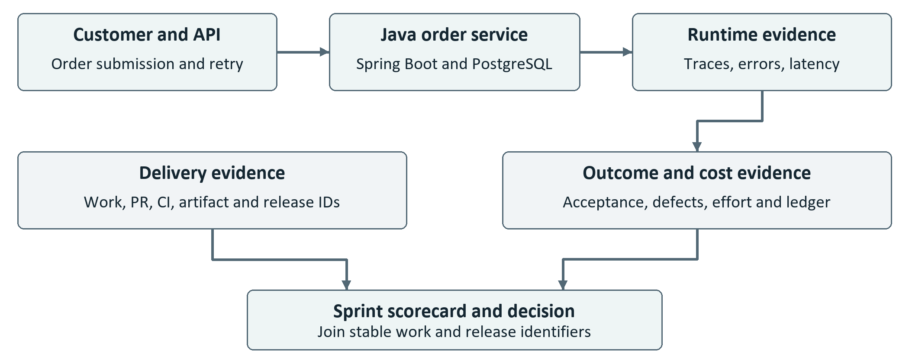
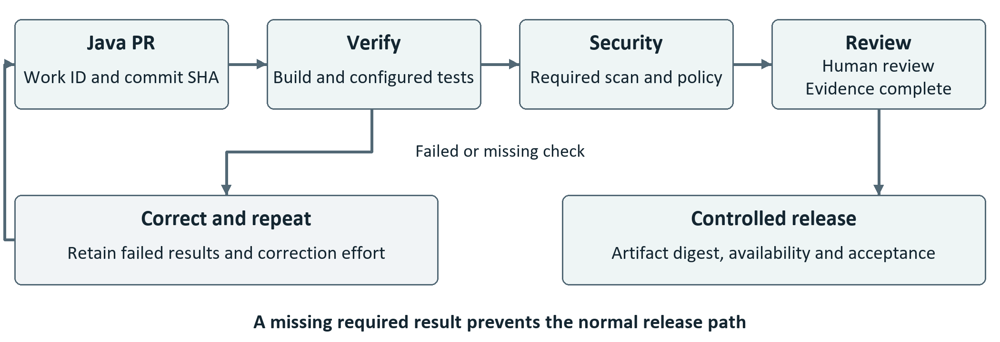

Paul Harding, MBA ITM

PolarSpark LLC

23 November 2026

# Engineering Impact Framework Java Application Workflow

This companion applies the Engineering Impact Framework to a Java team maintaining an order service. It turns Baseline, Adoption, and Improvement into repeatable delivery steps, evidence records, and decisions. Use the companion framework for complete metric definitions and the template pack for editable worksheets (Harding).

The application accepts orders, stores them in PostgreSQL, and exposes order status to authenticated customers. The example change adds idempotent order submission so a customer retry does not create a second order. The team includes Java developers, QA, a platform engineer, a security partner, and a product owner.

All counts, durations, costs, targets, and assessment results in this companion are invented teaching examples. They are not PolarSpark client results or industry benchmarks. Real adoption decisions require the organization’s own evidence.

Read pages 2 through 7 to establish the current state, pages 8 through 15 to evaluate adoption, and pages 16 through 19 to test an adjustment and decide what follows. Page 20 contains Works Cited. Two week sprints organize the review cadence; production evidence and customer outcomes may mature later.

## **Choose tools and freeze the configuration**

Use an organization approved Java JDK, Spring Boot, Maven Wrapper, JUnit, and PostgreSQL. IntelliJ IDEA or Eclipse provides the developer workspace. GitHub Issues records work; GitHub pull requests record review; GitHub Actions runs the organization’s configured build and release jobs. Equivalent approved products can replace any example tool.

Maven Surefire runs unit tests during the test phase. A configured integration test stage must also run before release. Spring Boot provides application testing support; choose the test scope appropriate to the behavior being checked ("Apache Maven Surefire"; "Testing Spring Boot Applications").

The candidate adoption is an approved IDE AI assistant, such as GitHub Copilot. Record the actual product, configuration, subscription cost, enabled capabilities, and known model identifier. Do not assume the product name establishes a fixed model or permission boundary.

Worksheet T01 records the initiative owner, approved work, prohibited data, rollout assignment, start date, cost boundary, and fallback. T02 records the tool versions and measurement extraction logic. Attach the dependency lock or resolved dependency report, CI workflow revision, scanner configuration, and environment identifiers. Do this before comparing results.

## **Separate application and delivery observability**

Figure 1 distinguishes runtime evidence from delivery evidence. Request traces help diagnose application behavior; they do not establish how many engineering hours an AI tool saved. Delivery records join work, review, release, acceptance, and costs.

The relationship is illustrated in figure 1.

Fig. 1. Java application and delivery evidence. Original framework diagram.

Choose one primary tracing instrumentation path. The OpenTelemetry Java agent can instrument supported libraries automatically; manual spans can add selected business operations. Verify duplicates, cardinality, redaction, and overhead before using the data ("Instrumentation Ecosystem").

Record trace sampling, retention, schema version, collector destination, metric ownership, and service name. Keep customer payloads and source code outside the measurement export. A release identifier can link runtime observations to a deployment without placing customer identifiers in sprint scorecards.

## **Define the evidence record**

Create one initiative ID, EIF-JAVA-01, and one version per material intervention. A work item such as ORD-142 can link to multiple pull requests. One deployment can contain multiple work items. Preserve those relationships without multiplying deployment counts or shared costs.

- Work record: item ID, work class, risk band, commitment timestamp, sprint, acceptance criteria, scope changes, and completion state.

- Delivery record: PR ID, commit SHA, ready for review time, substantive review time, CI run ID, artifact digest, deployment ID, service, environment, and production availability timestamp.

- Outcome record: acceptance timestamp, accepting role, defect or incident reference, observation cutoff, and business outcome event definition.

- Exposure and effort: rollout assignment, actual AI use yes/no/unknown, task class, sampled person-hours by activity, collection method, coverage, and uncertainty.

Store timestamps in UTC and document the reporting timezone. Record source extraction time and excluded records. T02 owns definitions; T03 through T05 reference the evidence snapshot. Reconcile unmapped work and deployments before calculating changes. Unknown exposure remains unknown, rather than becoming a nonuser record.

## **Baseline workflow for a Java developer**

At Sprint Planning, the product owner defines the retry behavior: repeating a request with the same idempotency key returns the original result; a conflicting request is rejected under an agreed contract. The developer records ORD-142 and its acceptance criteria before implementation.

1. Inspect the current controller, service transaction, persistence model, and API contract. Record a design decision covering concurrency, key scope, expiry, and error handling.

2. Write tests for ordinary submission, repeated submission, conflicting payloads, concurrent requests, and authorization boundaries. Include a database backed check of the uniqueness rule.

3. Implement the change, update API guidance, and submit a PR linked to ORD-142. Record ready for review time. Reviewers inspect the design, failure behavior, tests, and documentation.

4. Run required build, test, dependency, secret, and static analysis checks. Record results and exceptions. Deploy the approved artifact using the existing release procedure.

Record availability and business acceptance separately. If AI is already used, retain that actual exposure in Baseline. A new AI product or workflow is then the incremental intervention. Baseline is the current operating state, not an imagined tool free history.

## **Collect baseline sprint observations**

Observe four complete sprints initially and extend the window when work volume or variation requires it. Freeze the eligible work class: maintenance changes to this service with comparable review and operational risk. Record feature and incident work separately. Preserve unfinished work and changes added after Sprint Planning.

Choose M01 time to accepted production value, M02 delivery effort per comparable outcome, and M03 realized net adoption value as the primary measures. Baseline M03 has no incremental adoption benefit to claim. Capture the cost reference and business assumptions needed for the later comparison.

Use M09 review waiting time and M12 build feedback time to explain delays. Pair M07 change fail rate, M14 escaped defects, M15 security exposure, and M16 required control execution with those measures. These are selected diagnostics and limits, not individual performance targets.

At each Sprint Review, confirm acceptance records and deployment joins. At the Retrospective, ask developers and reviewers about rework, waiting, and documentation. Close T03 and T06 at a declared cutoff. Keep recent release cohorts provisional until their equal follow-up window ends. DORA delivery concepts support service improvement and require consistent operational counting rules (Harvey).

## **Reconcile the illustrative baseline**

Assume the four baseline sprints contain 40 comparable accepted production outcomes and 800 attributed delivery hours. The hours include development, review, QA, security, documentation, operations, and corrective effort on the stated period basis. M02 is 800 divided by 40, or 20 hours per outcome.

The adopter workstream has a median M01 of 10 calendar days. A separately assigned comparison workstream also has a median of 10 days. Keep the underlying durations, count, and 85th percentile in T03; a median alone does not describe the tail.

Check the baseline before use: are 40 outcomes matched to production and acceptance evidence? Are sampled hours representative? Were failed or abandoned tasks excluded from effort by mistake? Are all release cohorts observed for the same period? Record the answers and any exclusions.

A sample calculation for M07 might use 1 failed production deployment out of 10, giving 10 percent. This small sample supports cautious description. It cannot establish that a later zero is a durable reliability improvement.

Baseline exit requires accountable owners to accept the scope, metric definitions, evidence limitations, costs, and risk conditions. If the records are unusable, improve collection and postpone an improvement claim. Record the decision in T12.

## **Write the adoption contract**

Version EIF-JAVA-01-A1 introduces the approved IDE assistant for test drafting and small service changes. It excludes production credentials, customer records, unapproved repositories, autonomous merge, and deployment. The developer remains responsible for understanding the change; reviewers apply the normal acceptance and release rules.

The hypothesis is that supported tasks require less total delivery effort and reach accepted production sooner without transferring work to reviewers or weakening controls. Select an illustrative practical threshold before rollout, such as a 10 percent reduction in M02. Set quality and security limits from existing policy and historical variation.

Assign rollout order prospectively across comparable workstreams where feasible. Preserve the assignment rule and pre-change trends. Assignment and actual use are different fields. A voluntary user comparison can reflect skill, motivation, or task selection and should not be described as randomized evidence.

Declare the learning period, evaluation window, applicable work, and stopping conditions in T01. Include learning and integration costs in the investment ledger, even if steady-operation measures are reported separately. Stop the affected use immediately for a material prohibited disclosure or unapproved privileged action under the existing incident process. NIST AI RMF provides the risk functions; these rollout rules are local choices (Tabassi).

## **Develop and evaluate the AI assisted change**

For ORD-142, the Java developer asks the approved assistant to propose test cases using a sanitized description of the idempotency contract. The developer checks whether the proposal covers duplicate requests, conflicting input, concurrency, and access boundaries. A plausible test name or passing build is insufficient evidence.

1. Record the task ID, approved tool configuration, actual use, output category, and review rubric version. Retain raw prompts only when approved and necessary; otherwise retain a safe evidence reference.

2. Review every generated dependency, SQL migration, exception path, and assertion. Confirm that tests would detect the intended failure. Reject or correct unsafe or irrelevant output and record the reason.

3. Measure prompting, verification, review, corrections, tests, and documentation effort together. Use M19 for first-review output acceptance and M20 for net task effort change.

Keep a held-out evaluation set separate from tuning examples. Include misleading repository text, invented APIs, sensitive context, and attempted unsafe commands where applicable. Record each case, result, critical failure, evaluator, and known tool version. The generative AI profile helps identify relevant risk categories; the evaluation rubric is specific to this workflow (Autio et al.).

## **Review and release with evidence**

Figure 2 shows where the Java delivery path produces evidence. This is a proposed local pipeline, not a claim that a product supplies these controls automatically.

The relationship is illustrated in figure 2.

Fig. 2. Java pull request and release evidence. Original framework diagram.

A PR job runs the repository’s Maven Wrapper verify command with configured unit and integration test plugins. Separate jobs run the approved security checks. Store run IDs, test reports, scan scope, workflow revision, and policy disposition. Do not infer full test execution merely from the command name.

A reviewer confirms behavior, evidence, and required documentation before merge. The release job publishes and deploys the approved artifact digest. Record production availability, recovery evidence, and subsequent business acceptance. A failing required check returns the change for correction or enters the organization’s documented exception process. Secure development expectations remain applicable to AI assisted changes (Souppaya et al.).

## **Close the adoption sprint scorecard**

Complete T04 with the sprint dates, initiative version, eligible work, rollout assignment, actual exposure, extraction cutoff, and observation status. Link the prior T03 baseline rather than copying and editing it. Preserve the population and metric versions used in both states.

Report each selected measure as baseline, current, change, sample size, evidence coverage, and interpretation. For rates, preserve numerator and denominator. For durations, preserve distributions. For missing or not yet mature outcomes, record pending or unassessed rather than zero.

An illustrative sprint has 10 eligible outcomes, 8 with documented AI use, 1 without use, and 1 unknown. M18 known use is 8 divided by 10, or 80 percent; unknown exposure is 10 percent. Report both. If 6 of 8 sampled AI outputs pass first review, M19 is 75 percent with the rejection reasons attached.

The developer pulse has 6 favorable responses out of 8 valid responses, or 75 percent, with 10 eligible respondents. The response rate is 80 percent. Show the question wording and response distribution. These observations inform interpretation and cannot substitute for the delivery measures. Assign every unresolved gap an owner and review date.

## **Compare delivery and attribute cautiously**

Assume the four post-change sprints produce 40 comparable outcomes using 640 delivery hours. M02 becomes 16 hours per outcome. The observed reduction is (20 minus 16) divided by 20, or 20 percent. Recovered task capacity is 4 hours multiplied by 40 outcomes, or 160 hours.

M01 falls from 10 to 8 days in the adopter workstream, a 20 percent observed reduction. In the comparison workstream it falls from 10 to 9.5 days. The adjusted change is (8 minus 10) minus (9.5 minus 10), or minus 1.5 days. Its magnitude is 15 percent of the adopter baseline.

This contrast is descriptive unless rollout allocation, earlier trends, and differential changes support a causal interpretation. Inspect changes in staffing, work mix, release approval, incidents, and business acceptance. Report the observations and uncertainty before describing why they changed.

Keep critical defect counts, security findings, reviewer effort, and unfinished work visible. A lower median with a worse tail or growing review burden may require adjustment. Reconcile the eligible population and equal observation period before comparing. Do not average sprint percentiles or use story points as money. The companion framework defines these local calculation rules (Harding).

## **Calculate value and separate capacity**

At an assumed loaded rate of USD 100 per hour, the 160 recovered hours have a capacity equivalent of USD 16,000. This amount stays outside realized financial benefit. Record where the capacity was reassigned and whether it produced an accepted outcome.

For the same eight week evaluation, assume finance verifies USD 12,000 in canceled incremental contractor expenditure and USD 18,000 in attributable incremental contribution after variable costs. Their evidence and overlap keys are distinct. Gross realized benefit is USD 30,000.

Incremental economic cost is USD 24,000: USD 6,000 for recurring tooling, USD 8,000 for integration, USD 8,000 for training, and USD 2,000 for evaluation and governance. M03 net value is USD 30,000 minus USD 24,000, or USD 6,000. Realized ROI is USD 6,000 divided by USD 24,000, or 25 percent.

T11 retains invoices, effort rates, allocation rules, realization dates, verification owners, and rejected or pending claims. Count no benefit twice across AI, workflow, and platform initiatives. Include transition cost in cumulative results. If no benefit has been verified, report the costs and pending benefits; do not relabel capacity as cash savings. These examples use the framework’s local recognition method (Harding).

## **Collect stakeholder and customer feedback**

Use T06 for Baseline, T07 for Adoption, and T08 for Improvement. Keep the core question wording stable and add phase specific prompts. Record role, phase, sprint, question version, eligible count, valid count, response distribution, and a deidentified evidence summary.

- Developers and engineers: Was the change easier to understand? Did prompting and correction add work? Did review waiting or cognitive burden change? Name a recent task that explains the answer.

- Security and operations: Were required checks complete and effective? Could you trace a change and recover it? What new failure or data handling concern appeared?

- Business stakeholders: Did the delivered behavior meet the acceptance criteria and arrive when useful? What verified contribution or avoided expenditure supports a benefit claim?

- Customers when appropriate: Could you complete the order once after a retry? Was the status clear? Record successful eligible attempts divided by eligible attempts and explain consent, sampling, and release exposure.

Use an approved minimum reporting group and suppress identifying comments. Do not treat a self-reported time saving as measured effort. At the Retrospective, connect feedback to evidence and choose one owned response. Retain dissent and adverse observations when the aggregate result is favorable.

## **Apply NIST adoption responsibilities**

NIST AI RMF organizes risk work through Govern, Map, Measure, and Manage. The functions apply across all three framework phases; they are not a sequence of approval stages (Tabassi).

- Govern: name the AI use owner, permitted data and actions, review authority, incident route, supplier responsibilities, and approved versions. Record decisions and exceptions in T10.

- Map: describe developer tasks, repository context, affected customers, downstream dependencies, privileges, foreseeable misuse, and fallback. Document why the assistant is suitable for this use.

- Measure: execute the held-out cases and review samples. Record M25 evaluation results, M26 oversight coverage, M27 incidents and near misses, and M28 tool availability and cost when relevant.

- Manage: restrict or stop failed uses, assign treatment owners, retest changed configurations, and monitor residual risk. Preserve the earlier approved state for fallback.

For this Java case, sensitive context leakage, fabricated APIs, weak assertions, and unsafe suggested commands are explicit evaluation categories. The generative AI profile supplies further considerations (Autio et al.). A passing local evaluation is bounded evidence for tested conditions. It does not confer NIST certification or eliminate normal secure development duties.

## **Assess maturity before an adjustment**

Use T09 to assess SDLC, documentation, and AI adoption separately. The framework’s proposed levels run from 0 absent to 4 measured and improved; U means unassessed. Award a level only when all required cumulative evidence is present. These are local scores, not official NIST or ISO ratings (Harding).

For documentation, inspect the order API contract, design decision, data migration guidance, test intent, deployment instructions, rollback runbook, and ownership. Sample whether another engineer can complete a knowledge task with them. A generated file without verified correctness is weak evidence.

Suppose six applicable domains have scores 3, 2, 2, 1, 3, and U. The assessed score sum is 11. The index is 11 divided by (4 times 5), multiplied by 100, or 55.0. Coverage is 5 divided by 6, or 83.3 percent. Publish both and identify the missing domain.

Review samples across at least two complete sprints and a relevant release or exercise for level 3 under the framework’s initial convention. Record assessor, evidence selection, date, owner, exceptions, and next action. A profile average cannot authorize a failed critical control. Select an improvement from the actual evidence, such as incomplete recovery instructions or a growing review queue.

## **Run an improvement sprint**

Version EIF-JAVA-01-A2 tests a review checklist and smaller PR batches after A1 evidence shows review waiting increased. Keep the approved assistant and security requirements stable where practical. Record concurrent changes that cannot be avoided. T05 compares A2 with both the original Baseline and A1.

The hypothesis is that earlier human review reduces M09 without increasing defects or total review effort. An illustrative target is a reduction from 18 to 12 median waiting hours. Freeze the PR readiness definition and exclude declared author draft intervals consistently. Record the median, 85th percentile, review cycles, and sample count.

Assume M01 improves from A1’s 8 days to A2’s 7.5 days. The marginal reduction is 0.5 divided by 8, or 6.25 percent. The cumulative observed reduction against the original 10 day baseline is 25 percent. These answer different questions and must remain separately labeled.

Use T08 to ask whether the checklist improved understanding or added avoidable work. Reconcile checklist training, facilitation, and monitoring cost in T11. If the tool or permissions also change, version and evaluate that intervention explicitly. Do not attribute every subsequent improvement to the original AI purchase.

## **Verify customer and business outcomes**

For this order service, define M22 as successful retry sessions divided by eligible retry sessions. An eligible session has at least one repeated order submission within the agreed session window. A successful session creates exactly one order and returns a usable confirmation within the stated timeout. Freeze eligibility, bot filtering, timeout, and event definitions in T02.

Illustrative Baseline evidence shows 180 successes in 200 eligible sessions, or 90 percent. Post-change evidence shows 190 in 200, or 95 percent. The observed change is 5 percentage points. The relative increase is 5 divided by 90, or about 5.6 percent. Keep these descriptions distinct.

Record release exposure, event coverage, missing confirmations, and duplicate order incidents. Compare similar customer segments and business periods. Check changes in payment providers, traffic, support practice, and seasonality before attributing the result to the Java change or AI assistance.

Customer feedback asks whether confirmation was clear and whether support was needed. The product owner verifies behavior; finance separately verifies incremental contribution after variable costs. The same accepted order cannot support overlapping benefit claims in several initiatives. Keep the customer result observable even when no reliable financial conversion exists. In T12, distinguish improvement in product behavior from evidence that the development intervention caused it.

## **Decide and retain the operating record**

At the planned checkpoint, the engineering lead, product owner, security partner, and benefit owner review T12. Consider outcome direction, materiality, uncertainty, realized value, developer experience, and control results together. Choose expand, continue observing, adjust, or discontinue the affected use.

The illustrative A1 arithmetic supports further consideration, but a critical security failure would block expansion. Small deployment samples or incomplete customer outcomes can justify continued observation. Record what additional evidence will change the decision, who owns it, and when it will be reviewed.

Retain the initiative versions, approved scope, baseline snapshots, metric definitions, extraction logic, work and release joins, cost ledger, benefit verification, feedback summaries, evaluation results, and decision rationale. Preserve corrections and original values when late defects or financial evidence arrive.

Hand ongoing operation to named owners. Verify fallback access and the rollback runbook. Schedule the next review in the ordinary delivery cadence and reassess maturity at a meaningful release or quarterly checkpoint. The completed record should let another reviewer reproduce the calculations and understand the limits of the claim. Use the template pack again for the next tooling or workflow change rather than erasing this intervention’s history.

## Works Cited

"Apache Maven Surefire." *Apache Maven*, Apache Software Foundation, [https://maven.apache.org/surefire/](https://maven.apache.org/surefire/). Accessed 23 Nov. 2026.

Autio, Chloe, et al. *Artificial Intelligence Risk Management Framework: Generative Artificial Intelligence Profile*. NIST AI 600-1, National Institute of Standards and Technology, 26 July 2024, [https://doi.org/10.6028/NIST.AI.600-1](https://doi.org/10.6028/NIST.AI.600-1).

Harding, Paul. *Engineering Impact Framework*. Version 1.2, PolarSpark LLC, 23 Nov. 2026.

Harvey, Nathen. "DORA's Software Delivery Performance Metrics." *DORA*, Google Cloud, 5 Jan. 2026, [https://dora.dev/guides/dora-metrics/](https://dora.dev/guides/dora-metrics/). Accessed 23 Nov. 2026.

"Instrumentation Ecosystem." *OpenTelemetry*, [https://opentelemetry.io/docs/languages/java/instrumentation/](https://opentelemetry.io/docs/languages/java/instrumentation/). Accessed 23 Nov. 2026.

Souppaya, Murugiah, et al. *Secure Software Development Framework (SSDF) Version 1.2: Recommendations for Mitigating the Risk of Software Vulnerabilities*. NIST SP 800-218, National Institute of Standards and Technology, Feb. 2022, [https://doi.org/10.6028/NIST.SP.800-218](https://doi.org/10.6028/NIST.SP.800-218).

Tabassi, Elham. *Artificial Intelligence Risk Management Framework (AI RMF 1.0)*. NIST AI 100-1, National Institute of Standards and Technology, 26 Jan. 2023, [https://doi.org/10.6028/NIST.AI.100-1](https://doi.org/10.6028/NIST.AI.100-1).

"Testing Spring Boot Applications." *Spring Boot*, [https://docs.spring.io/spring-boot/reference/testing/spring-boot-applications.html](https://docs.spring.io/spring-boot/reference/testing/spring-boot-applications.html). Accessed 23 Nov. 2026.
