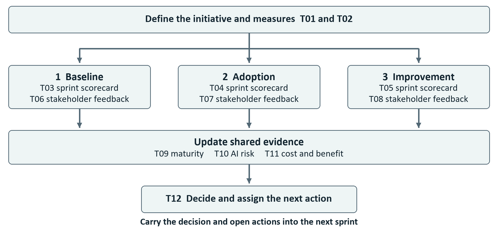

**PolarSpark LLC**

IMPLEMENTATION WORKBOOK

# Engineering Impact Framework Workbook

Sprint scorecards and stakeholder feedback templates

**Paul Harding, MBA ITM**

PolarSpark LLC  |  [https://polarspark.com/](https://polarspark.com/)

Version 1.3  |  23 November 2026

Use this workbook to document a proposed change, establish a defensible baseline, close sprint observations, and reconcile costs and verified benefits. The records support decisions across Baseline, Adoption, and Improvement.

Copy a fresh form for each initiative or reporting window. Keep stable metric definitions, evidence references, responsible owners, and unresolved findings. Use the companion white paper for the full metric catalogue, maturity rubric, and value recognition rules.

**Included records** Adoption contract, metric definitions, three phase scorecards, role specific feedback, maturity assessment, AI risk record, value ledger, and evaluation decision.

## Using this workbook

Reusable forms for the Engineering Impact Framework. Version 1.3, November 23 2026. Copy a fresh form for each initiative, sprint, assessment, or decision. Replace bracketed prompts with local records. Preserve earlier versions.

Metric IDs M01 to M28 refer to the definitions in the framework document. These are editable Word forms for manual completion. Calculations are not automated. Complete the numerator, denominator, sample, source, and period fields before interpreting a result.

**Table 1. Engineering Impact Framework Workbook**

| **Template** | **Purpose** | **Phase** |
| --- | --- | --- |
| T01 | Adoption contract and readiness | 1 and material changes |
| T02 | Metric definition record | All |
| T03 | Baseline sprint scorecard | 1 |
| T04 | Adoption sprint scorecard | 2 |
| T05 | Adjustment sprint scorecard | 3 |
| T06 | Baseline stakeholder feedback | 1 |
| T07 | Adoption stakeholder feedback | 2 |
| T08 | Adjustment stakeholder feedback | 3 |
| T09 | Maturity assessment | All checkpoints |
| T10 | AI use case and risk record | All |
| T11 | Cost and benefit ledger with value summary | All |
| T12 | Evaluation decision and improvement action | All checkpoints |

### Completion rules

Use Not assessed until evidence is available. Distinguish zero, unavailable, provisional, and not applicable. A blank result never means a pass. Apply existing organizational security and release policies. Keep identifiable responses and sensitive technical evidence in their governed systems.

Each scorecard should show the reporting window, data cutoff, intervention version, and sample coverage. Late acceptance, defects, and value verification may require a later revision. Retain a link to that revision in the original scorecard.

These forms implement the companion *Engineering Impact Framework* [17]. Their delivery concepts draw on DORA and Scrum [3, 5]. Their maturity and AI risk records use the published NIST foundations while retaining local scoring and approval rules [6, 7].

## Choosing and closing sprint records

Choose the scorecard and stakeholder feedback form that match the initiative phase. Shared records carry forward across phases so that risks, maturity evidence, and value claims remain traceable.

The relationship is illustrated in figure 1.

Fig. 1. Phase specific forms feed shared evidence and the next accountable decision. Original framework diagram.

### Complete the record in the right order

Confirm the initiative version and metric definitions before the sprint. At sprint close, update the scorecard and feedback results, then reconcile the shared evidence. T12 records the permitted next step, accountable owner, conditions, and next checkpoint.

### Keep pending evidence visible

Customer outcomes, later defects, and verified financial benefits may arrive after sprint close. Mark them pending or provisional and link the later update. Carry open actions into the next sprint instead of treating a completed form as proof that the outcome has been achieved.

## T01 Adoption contract

**Initiative ID and version** [Enter ID, version, owner, and date]

**Application and team** [Enter service, team, business sponsor, and scope]

**Problem and desired outcome** [Describe the delivery problem and why improvement matters]

**Current practice** [Record existing AI, tools, workflow, permissions, and relevant maturity gaps]

**Proposed change and hypothesis** [State the change, expected mechanism, eligible work, and affected people]

**Table 2. T01 Adoption contract**

| **Required planning field** | **Local definition** |
| --- | --- |
| Baseline window | [Sprints and dates] |
| Learning and evaluation windows | [Dates, cutoff, and outcome follow-up] |
| Eligible work and comparison | [Classification, assignment rule, exclusions, and rationale] |
| Primary measures | [M01 M02 M03 and locally justified thresholds] |
| Diagnostics and guardrails | [Selected IDs, boundaries, and breach response] |
| Cost and benefit boundaries | [Currency, period, rate source, expected benefits, and overlap rule] |
| Known concurrent changes | [Staffing, incidents, releases, or other tooling] |
| Fallback and exit criteria | [How to restrict or stop the use and who acts] |

**Local framework departures** [Record changed conventions and their effective dates]

## T01 Readiness and authorization record

Complete before the affected adoption scope begins. Reuse this page when a material scope or permission change occurs. These are local organizational decision fields, not a NIST certification checklist.

**Initiative and proposed scope** [Enter initiative version and permitted actions]

**Table 3. T01 Readiness and authorization record**

| **Readiness condition** | **Evidence and owner** | **Result** |
| --- | --- | --- |
| Baseline and data gaps understood | [Link and owner] | Not assessed |
| Eligible work and comparison defined | [Link and owner] | Not assessed |
| Business outcome and thresholds defined | [Link and owner] | Not assessed |
| Approved AI use and data handling | [T10 link and owner] | Not assessed |
| Permissions and oversight boundary | [T10 link and owner] | Not assessed |
| Required testing and security controls | [Evidence and owner] | Not assessed |
| Training and support available | [Evidence and owner] | Not assessed |
| Fallback and incident handling defined | [Evidence and owner] | Not assessed |
| Costs and evaluation ownership assigned | [T11 link and owner] | Not assessed |

**Open conditions or exceptions** [State consequence, authority, expiry, and permitted scope]

**Decision** [Proceed within stated scope, resolve conditions, or do not proceed]

**Accountable owners and decision date** [Record delivery, product, metric, security, AI risk, and finance owners as applicable]

**Next review** [Enter date and triggering events]

## T02 Metric definition record

Copy one record per selected metric or local variant. Keep the prior definition when the meaning changes.

**Metric identity** [Enter metric ID, name, version, and owner]

**Decision supported** [Explain what movement would cause the team to do]

**Table 4. T02 Metric definition record**

| **Definition field** | **Local specification** |
| --- | --- |
| Population and grain | [Eligible entities, service, work class, and one-row meaning] |
| Calculation and unit | [Formula in words, numerator, denominator, and unit] |
| Timing | [Start event, end event, window, timezone, and follow-up] |
| Source and linkage | [Systems, stable IDs, joins, and de-duplication] |
| Aggregation | [Rate method, duration percentiles, cohort rule, and sample count] |
| Exclusions and unknowns | [Excluded cases, unknown handling, and not-applicable rule] |
| Coverage and freshness | [Expected records, matched records, cutoff, and extraction lag] |
| Threshold and guardrails | [Direction, practical threshold, risk limit, and rationale] |
| Comparison and uncertainty | [Baseline, control group, variation, limitations, and analyst method] |
| Change control | [Effective date, approver, and historical restatement rule] |

**Worked calculation and validation** [Include a representative record or arithmetic check and its source]

**Known limitations** [Explain what the measure cannot establish]

## T03 Phase 1 baseline sprint scorecard

**Context** [Initiative and current-state version; team; service; sprint; owner]

**Window and evidence** [Start; end; timezone; cutoff; source snapshot; outcome follow-up]

**Work mix and capacity** [Committed, added, removed, completed, accepted, open; classes; available capacity]

**Existing AI and other changes** [Record exposure yes no unknown and concurrent operational changes]

**Table 5. T03 Phase 1 baseline sprint scorecard**

| **ID** | **Measure** | **Sprint value** | **Window value** | **N or n/d** | **Evidence** |
| --- | --- | --- | --- | --- | --- |
| M01 | Time to accepted value | [Median p85] | [Median p85] | [N] | [Link] |
| M02 | Effort or cost per outcome | [Value] | [Value] | [Hours N] | [Link] |
| M03 | Adoption value status | Not evaluated | Not evaluated | [Scope] | [T11] |
| [ID] | Delivery diagnostic | [Value] | [Value] | [N or n/d] | [Link] |
| [ID] | Quality or security | [Value] | [Value] | [N or n/d] | [Link] |
| [ID] | Experience or outcome | [Value] | [Value] | [N or n/d] | [Link] |

In Phase 1, record current cost and benefit boundaries in T11. M03 is not yet evaluated for the proposed change. Recompute window rates and percentiles from underlying records. N is sample count; n/d is numerator divided by denominator; p85 is the 85th percentile.

**Table 6. T03 Phase 1 baseline sprint scorecard**

| **Required baseline evidence** | **Finding and next action** |
| --- | --- |
| Data gaps and provisional cohorts | [Coverage, unmatched records, missingness, late outcomes] |
| Maturity and critical gaps | [T09 profile indices, coverage, and critical conditions] |
| Stakeholder feedback | [T06 roles, eligible counts, responses, and themes] |
| AI risk readiness | [T10 open risks and required treatment] |

**Baseline decision** [Sufficient, extend collection, or restricted interpretation; rationale and owner]

**Next action and checkpoint** [Action, accountable owner, due date, and evidence required]

## T04 Phase 2 adoption sprint scorecard

**Context** [Initiative and intervention version; service; team; sprint; owner]

**Window and exposure** [Dates; timezone; cutoff; learning or steady period; assigned group; actual and unknown exposure]

**Comparability** [Work mix; capacity; concurrent changes; comparison group; source snapshot and follow-up]

**Table 7. T04 Phase 2 adoption sprint scorecard**

| **ID** | **Measure** | **Baseline** | **Post change** | **N or n/d** | **Change** |
| --- | --- | --- | --- | --- | --- |
| M01 | Time to accepted value | [Median p85] | [Median p85] | [Both N] | [Days %] |
| M02 | Effort or cost per outcome | [Value] | [Value] | [Both N] | [Hours %] |
| M03 | Realized net value | [Boundary] | [Currency] | [T11] | [Cumulative] |
| [ID] | Selected diagnostic | [Value] | [Value] | [Both] | [Unit] |
| [ID] | Selected diagnostic | [Value] | [Value] | [Both] | [Unit] |

**Comparison group and adjusted contrast** [Show baseline and post values; compute same-unit changes; state assumptions]

**Table 8. T04 Phase 2 adoption sprint scorecard**

| **Guardrail** | **Limit** | **Observed and evidence** | **Result** |
| --- | --- | --- | --- |
| Quality and reliability | [Local limit] | [Value source] | Not assessed |
| Security and AI risk | [Local limit] | [Value source] | Not assessed |
| Review and human impact | [Local limit] | [Value source] | Not assessed |

**Value and stakeholder findings** [T11 actual cost, capacity separately, verified benefit; T07 response counts and themes]

**Sprint response** [Continue, restrict, adjust, or escalate; rationale, owner, and next checkpoint]

State observed, provisional, or unavailable for each result. An evaluation decision is recorded in T12. Guardrail breaches receive immediate action under existing policy.

## T05 Phase 3 adjustment sprint scorecard

**Context** [Initiative; original version; previous version; adjustment version; sprint; owner]

**Adjustment hypothesis** [Specific bottleneck, change, expected effect, date, cost, and affected risk]

**Window and comparability** [Dates; cutoff; work mix; capacity; exposure; source snapshot; follow-up]

**Table 9. T05 Phase 3 adjustment sprint scorecard**

| **ID** | **Measure** | **Original** | **Previous** | **Adjusted** | **Marginal change** |
| --- | --- | --- | --- | --- | --- |
| M01 | Accepted value time | [Value] | [Value] | [Value] | [Days %] |
| M02 | Effort or cost | [Value] | [Value] | [Value] | [Unit %] |
| M03 | Net realized value | [Boundary] | [Value] | [Value] | [Currency] |
| [ID] | Targeted diagnostic | [Value] | [Value] | [Value] | [Unit] |
| [ID] | Relevant guardrail | [Value] | [Value] | [Value] | [Unit] |

**Sample and evidence quality** [N or numerators and denominators for each state; sources; missingness; provisional outcomes]

**Cumulative result** [Compare adjusted state with original baseline; retain the comparison-group result]

**Sustained benefit and risk** [Check benefit erosion, new costs, transferred effort, evaluation results, and fallback]

**Stakeholders and maturity** [T08 findings and response counts; relevant T09 changes with evidence]

**Decision and next action** [Keep, revise, revert, or observe; owner; due date; acceptance evidence; T12 link]

Marginal improvement compares adjusted with previous state. Cumulative improvement compares adjusted with the original baseline. Retain failed adjustments and their costs.

## T06 Phase 1 baseline stakeholder feedback

Copy this form for each respondent. Ask the four core questions consistently across phases for internal roles. Ask the relevant role question and use the open responses to explain the rating. Customers receive only applicable customer questions and follow-up, without internal productivity questions.

**Response context** [Initiative; phase; version or release; sprint or date; role; exposure yes no unknown]

Agreement scale: 1 strongly disagree, 2 disagree, 3 neither agree nor disagree, 4 agree, 5 strongly agree. Use N/A when the respondent lacks relevant experience. Do not code N/A as a midpoint.

**Table 10. T06 Phase 1 baseline stakeholder feedback**

| **ID** | **Stable internal question** | **Response** |
| --- | --- | --- |
| C1 | I can obtain the information I need to complete my work. | [1-5 or N/A] |
| C2 | Our workflow provides timely and useful feedback. | [1-5 or N/A] |
| C3 | I can maintain the required quality within normal working hours. | [1-5 or N/A] |
| C4 | Responsibilities and handoffs are clear. | [1-5 or N/A] |

**Table 11. T06 Phase 1 baseline stakeholder feedback**

| **Role** | **Phase specific question** | **Response** |
| --- | --- | --- |
| Developers | I can understand and safely change the code in my assigned work. | [1-5 or N/A] |
| Engineers and platform | Our environments and build tools support delivery without recurring workarounds. | [1-5 or N/A] |
| QA and operations | Delivered changes include the evidence and support information I need. | [1-5 or N/A] |
| Security | I can identify required controls and verify how changes meet them. | [1-5 or N/A] |
| Business and product | Delivered outcomes meet the agreed need at a useful time. | [1-5 or N/A] |
| Customers if relevant | I can complete the intended task reliably using the current application. | [1-5 or N/A] |

**Example and effect** [Describe a specific task or event, its effect, and any effort moved to another role]

**Improvement or concern** [What should change next; include any quality, security, customer, or knowledge concern]

Report urgent risks through the existing incident channel immediately. Participation and identity handling follow local policy. Preserve the core question wording when comparing phases; phase-specific questions are interpreted separately.

**Aggregator record** [Eligible and valid responses by role; N/A count; distribution; median; favorable share; themes; owner action]

## T07 Phase 2 adoption stakeholder feedback

Copy this form for each respondent. Ask the four core questions consistently across phases for internal roles. Ask the relevant role question and use the open responses to explain the rating. Customers receive only applicable customer questions and follow-up, without internal productivity questions.

**Response context** [Initiative; phase; version or release; sprint or date; role; exposure yes no unknown]

Agreement scale: 1 strongly disagree, 2 disagree, 3 neither agree nor disagree, 4 agree, 5 strongly agree. Use N/A when the respondent lacks relevant experience. Do not code N/A as a midpoint.

**Table 12. T07 Phase 2 adoption stakeholder feedback**

| **ID** | **Stable internal question** | **Response** |
| --- | --- | --- |
| C1 | I can obtain the information I need to complete my work. | [1-5 or N/A] |
| C2 | Our workflow provides timely and useful feedback. | [1-5 or N/A] |
| C3 | I can maintain the required quality within normal working hours. | [1-5 or N/A] |
| C4 | Responsibilities and handoffs are clear. | [1-5 or N/A] |

**Table 13. T07 Phase 2 adoption stakeholder feedback**

| **Role** | **Phase specific question** | **Response** |
| --- | --- | --- |
| Developers | I can understand and maintain the AI-assisted changes I use or review. | [1-5 or N/A] |
| Engineers and platform | The adopted tooling works reliably within approved permissions. | [1-5 or N/A] |
| QA and operations | I can verify and support changes produced through the adopted workflow. | [1-5 or N/A] |
| Security | I have enough evidence to evaluate AI-related data handling and control risks. | [1-5 or N/A] |
| Business and product | The adopted workflow is helping deliver the intended business outcome. | [1-5 or N/A] |
| Customers if relevant | I can complete the intended task reliably using the released application. | [1-5 or N/A] |

**Example and effect** [Describe a specific task or event, its effect, and any effort moved to another role]

**Improvement or concern** [What should change next; include any quality, security, customer, or knowledge concern]

Report urgent risks through the existing incident channel immediately. Participation and identity handling follow local policy. Preserve the core question wording when comparing phases; phase-specific questions are interpreted separately.

**Aggregator record** [Eligible and valid responses by role; N/A count; distribution; median; favorable share; themes; owner action]

## T08 Phase 3 adjustment stakeholder feedback

Copy this form for each respondent. Ask the four core questions consistently across phases for internal roles. Ask the relevant role question and use the open responses to explain the rating. Customers receive only applicable customer questions and follow-up, without internal productivity questions.

**Response context** [Initiative; phase; version or release; sprint or date; role; exposure yes no unknown]

Agreement scale: 1 strongly disagree, 2 disagree, 3 neither agree nor disagree, 4 agree, 5 strongly agree. Use N/A when the respondent lacks relevant experience. Do not code N/A as a midpoint.

**Table 14. T08 Phase 3 adjustment stakeholder feedback**

| **ID** | **Stable internal question** | **Response** |
| --- | --- | --- |
| C1 | I can obtain the information I need to complete my work. | [1-5 or N/A] |
| C2 | Our workflow provides timely and useful feedback. | [1-5 or N/A] |
| C3 | I can maintain the required quality within normal working hours. | [1-5 or N/A] |
| C4 | Responsibilities and handoffs are clear. | [1-5 or N/A] |

**Table 15. T08 Phase 3 adjustment stakeholder feedback**

| **Role** | **Phase specific question** | **Response** |
| --- | --- | --- |
| Developers | The adjusted workflow supports changes I can understand and maintain. | [1-5 or N/A] |
| Engineers and platform | The adjustment addresses the identified operating bottleneck. | [1-5 or N/A] |
| QA and operations | The adjusted workflow preserves the evidence and supportability I need. | [1-5 or N/A] |
| Security | The adjustment preserves required controls and addresses identified AI risks. | [1-5 or N/A] |
| Business and product | The adjustment is improving the intended business outcome. | [1-5 or N/A] |
| Customers if relevant | I can complete the intended task reliably after the relevant release. | [1-5 or N/A] |

**Example and effect** [Describe a specific task or event, its effect, and any effort moved to another role]

**Improvement or concern** [What should change next; include any quality, security, customer, or knowledge concern]

Report urgent risks through the existing incident channel immediately. Participation and identity handling follow local policy. Preserve the core question wording when comparing phases; phase-specific questions are interpreted separately.

**Aggregator record** [Eligible and valid responses by role; N/A count; distribution; median; favorable share; themes; owner action]

## T09 SDLC and documentation assessment

**Assessment context** [Initiative; service; phase; dates; assessor; owners; evidence window]

The domain references are ISO/IEC/IEEE 12207:2026 and 15289:2019 [1, 2]. Scores and evidence thresholds are local framework definitions.

Use the domain definitions in the framework. Scores: 0 absent, 1 ad hoc, 2 defined, 3 verified in operation, 4 measured and improved. U means unassessed. NA requires an approved applicability rationale. Copy additional rows for each domain.

**Table 16. T09 SDLC and documentation assessment**

| **Profile and domain** | **Score** | **Evidence and sample** | **Gap and owner** |
| --- | --- | --- | --- |
| SDLC planning and requirements | [0-4 U NA] | [Links N selection] | [Action owner date] |
| SDLC architecture and development | [0-4 U NA] | [Links N selection] | [Action owner date] |
| SDLC verification and quality | [0-4 U NA] | [Links N selection] | [Action owner date] |
| SDLC secure delivery | [0-4 U NA] | [Links N selection] | [Action owner date] |
| SDLC release and operations | [0-4 U NA] | [Links N selection] | [Action owner date] |
| SDLC learning and measurement | [0-4 U NA] | [Links N selection] | [Action owner date] |
| Documentation requirements and acceptance | [0-4 U NA] | [Links N selection] | [Action owner date] |
| Documentation architecture and decisions | [0-4 U NA] | [Links N selection] | [Action owner date] |
| Documentation development and interfaces | [0-4 U NA] | [Links N selection] | [Action owner date] |
| Documentation testing and quality | [0-4 U NA] | [Links N selection] | [Action owner date] |
| Documentation security and AI use | [0-4 U NA] | [Links N selection] | [Action owner date] |
| Documentation operations and recovery | [0-4 U NA] | [Links N selection] | [Action owner date] |

Complete the AI profile and profile calculations on the following page. Each level requires the applicable evidence described in the framework. Critical gaps remain visible regardless of the index.

## T09 AI assessment and profile summary

**Assessment context** [Same initiative, scope, dates, and assessor as the preceding assessment page]

**Table 17. T09 AI assessment and profile summary**

| **Profile and domain** | **Score** | **Evidence and sample** | **Gap and owner** |
| --- | --- | --- | --- |
| AI governance and capability | [0-4 U NA] | [Links N selection] | [Action owner date] |
| AI use context and impact | [0-4 U NA] | [Links N selection] | [Action owner date] |
| AI evaluation and oversight | [0-4 U NA] | [Links N selection] | [Action owner date] |
| AI treatment and continuity | [0-4 U NA] | [Links N selection] | [Action owner date] |

**Table 18. T09 AI assessment and profile summary**

| **Profile** | **Score sum** | **Scored domains** | **Applicable domains** | **Index and coverage** |
| --- | --- | --- | --- | --- |
| SDLC | [Sum] | [N] | [N] | [Percent and percent] |
| Documentation | [Sum] | [N] | [N] | [Percent and percent] |
| AI adoption | [Sum] | [N] | [N] | [Percent and percent] |

Index is score sum divided by four times scored domains, multiplied by 100. Coverage is scored domains divided by applicable domains, multiplied by 100. An index with no scored domains is undefined. Use equal domain weights.

**Critical gaps and applicability decisions** [List separately from indices; include risk consequence, approval, and NA rationales]

**Assessment decision and next review** [Record profile changes, action owner, evidence required, and review date]

## T10 AI use case and risk record

**Use case inventory** [Initiative; use case ID; tool and vendor; known model version; owner; phase; date]

Tailor this record to the AI RMF and the generative AI profile where relevant [6, 8]. The form is a local implementation tool.

**Context and affected people** [Task; benefit; users; affected customers or groups; prohibited uses]

**Data and privileges** [Input data classes; destinations and retention; repository access; command and deployment permissions]

**Human oversight and fallback** [Approval boundary; responsible reviewer; override; provider outage or retirement plan]

**Table 19. T10 AI use case and risk record**

| **Risk ID and scenario** | **Consequence and tolerance** | **Treatment and owner** | **Residual decision** |
| --- | --- | --- | --- |
| [ID incorrect output] | [Impact tolerance] | [Control owner date] | Not assessed |
| [ID data exposure] | [Impact tolerance] | [Control owner date] | Not assessed |
| [ID unsafe action] | [Impact tolerance] | [Control owner date] | Not assessed |
| [ID other relevant risk] | [Impact tolerance] | [Control owner date] | Not assessed |

**Table 20. T10 AI use case and risk record**

| **Evaluation record** | **Result and evidence** |
| --- | --- |
| Test set, scope, and configuration | [ID version held-out cases repeated trials evaluator date] |
| Acceptance criteria and findings | [By risk category; critical failures; limitations; M25-M27] |
| Monitoring and reporting | [Events owners cadence incident channel and change triggers] |
| NIST reference mapping | [Applicable function or subcategory; local interpretation; evidence] |

**Risk authority decision** [Permitted scope; conditions; residual risk owner; exception expiry; next review]

## T11 Cost and benefit ledger

Copy a ledger row for every cost or benefit. Keep each amount on a consistent currency and economic or cash basis. Benefits require independent verification and overlap reconciliation before recognition.

**Ledger context** [Initiative; phase; version; period; currency; cost basis; owner; cutoff]

**Table 21. T11 Cost and benefit ledger**

| **ID** | **Type and category** | **Quantity and unit** | **Rate** | **Amount** | **State** |
| --- | --- | --- | --- | --- | --- |
| [ID] | [Cost subscription] | [Qty unit] | [Rate] | [Value] | [Actual forecast] |
| [ID] | [Cost training] | [Hours] | [Rate] | [Value] | [Actual forecast] |
| [ID] | [Cost integration] | [Hours] | [Rate] | [Value] | [Actual forecast] |
| [ID] | [Cost support review] | [Hours] | [Rate] | [Value] | [Actual forecast] |
| [ID] | [Benefit reduction] | [Qty unit] | [Rate] | [Value] | [Proposed verified] |
| [ID] | [Benefit contribution] | [Qty unit] | [Rate] | [Value] | [Proposed verified] |
| [ID] | [Capacity only] | [Hours] | [Rate] | [Value] | [Potential] |

### Evidence record for each ledger ID

**Evidence and verifier** [Ledger ID; source; baseline or counterfactual; verification owner; date]

**Attribution and allocation** [Method; eligible scope; share assigned; associated initiatives; uncertainty]

**Overlap reconciliation** [Overlap key; linked capacity or outcome; excluded duplicate amounts; reviewer]

**Recognition period and assumptions** [Realization date; actual or forecast; rate source; one-time or recurring; cost allocation]

Multiply quantity by rate only when appropriate to the category. Preserve directly evidenced totals where applicable. Do not recognize speculative avoided incidents as realized cash benefit. Retain negative and rejected rows.

## T11 Value summary and reconciliation

**Summary context** [Initiative; phase; version; period; currency; economic or cash basis; verifier]

**Table 22. T11 Value summary and reconciliation**

| **Value component** | **Current period** | **Cumulative** | **Evidence** |
| --- | --- | --- | --- |
| Verified cost reductions | [Amount] | [Amount] | [Ledger IDs] |
| Verified avoided expenditure | [Amount] | [Amount] | [Ledger IDs] |
| Verified incremental contribution | [Amount] | [Amount] | [Ledger IDs] |
| Gross realized benefit | [Sum above] | [Sum above] | [Overlap checked] |
| Recurring incremental cost | [Amount] | [Amount] | [Ledger IDs] |
| One-time and transition cost | [Amount] | [Amount] | [Ledger IDs] |
| Other incremental cost | [Amount] | [Amount] | [Ledger IDs] |
| Total incremental cost | [Sum costs] | [Sum costs] | [Allocation checked] |
| Net realized value | [Benefit less cost] | [Benefit less cost] | [Verified] |
| Realized ROI | [Net / cost x 100] | [Net / cost x 100] | [Percent or undefined] |

**Capacity reported separately** [Recovered hours; work classes; sampled coverage; loaded rate; potential equivalent; redeployment]

**Unrecognized or modeled benefits** [Pending benefits; scenarios; risk reduction model; limitations]

**Double counting and cost completeness** [Confirm overlaps, shared allocation, transition costs, and common period and basis]

**Verification and next checkpoint** [Verifier; date; unresolved evidence; owner; review date]

Only verified realized benefits enter realized ROI. A zero cost denominator makes ROI undefined. An unverified benefit remains pending. M03 can be negative.

## T12 Evaluation decision and improvement action

**Decision context** [Initiative; phase; version; scope; decision date; accountable authority]

**Evidence reviewed** [Scorecards; metric versions; comparison; samples; value ledger; feedback; risk and maturity records]

**Table 23. T12 Evaluation decision and improvement action**

| **Decision consideration** | **Finding and consequence** |
| --- | --- |
| Primary outcomes and practical thresholds | [Baseline post change adjusted contrast and limitations] |
| Value and affordability | [Actual cost verified benefit net value capacity separately] |
| Quality and security guardrails | [Pass fail or unassessed with evidence and action] |
| Stakeholder and customer effects | [Roles response counts themes and material disagreement] |
| Evidence sufficiency | [Missing data small samples delayed outcomes and causal limits] |
| AI risk and maturity gaps | [Residual risks conditions critical gaps and ownership] |

**Decision and rationale** [Expand, continue observing, adjust, discontinue, or restrict; name permitted scope]

**Table 24. T12 Evaluation decision and improvement action**

| **Action** | **Owner and due date** | **Acceptance evidence** |
| --- | --- | --- |
| [Action or adjustment hypothesis] | [Owner date] | [Metric result or control evidence] |
| [Documentation or training update] | [Owner date] | [Verified use or task outcome] |
| [Evaluation or risk treatment] | [Owner date] | [Result and risk decision] |

**Conditions and dissent** [Exceptions, expiry, affected parties, differing interpretations, and escalation]

**Next review and fallback** [Date; triggers; who acts; previous approved state; communication owner]

## References and source notes

References support the stated concepts. The framework’s metric extensions, value calculations, maturity scores, templates, and diagrams are local design choices. ISO references use public descriptions and abstracts rather than a clause by clause conformity assessment.

[1] *ISO/IEC/IEEE 12207:2026: Systems and Software Engineering: Software Life Cycle Processes*. International Organization for Standardization, Apr. 2026, [https://www.iso.org/standard/90219.html](https://www.iso.org/standard/90219.html). Accessed 23 Nov. 2026.

[2] *ISO/IEC/IEEE 15289:2019: Systems and Software Engineering: Content of Life-Cycle Information Items (Documentation)*. International Organization for Standardization, July 2019, [https://www.iso.org/standard/74909.html](https://www.iso.org/standard/74909.html). Accessed 23 Nov. 2026.

[3] Harvey, Nathen. "DORA's Software Delivery Performance Metrics." *DORA*, Google Cloud, 5 Jan. 2026, [https://dora.dev/guides/dora-metrics/](https://dora.dev/guides/dora-metrics/). Accessed 23 Nov. 2026.

[5] Schwaber, Ken, and Jeff Sutherland. *The Scrum Guide: The Definitive Guide to Scrum: The Rules of the Game*. Scrum Guides, Nov. 2020, [https://scrumguides.org/scrum-guide.html](https://scrumguides.org/scrum-guide.html). Accessed 23 Nov. 2026.

[6] Tabassi, Elham. *Artificial Intelligence Risk Management Framework (AI RMF 1.0)*. NIST AI 100-1, National Institute of Standards and Technology, 26 Jan. 2023, [https://doi.org/10.6028/NIST.AI.100-1](https://doi.org/10.6028/NIST.AI.100-1).

[7] "AI RMF Core." *NIST AI Resource Center*, National Institute of Standards and Technology, [https://airc.nist.gov/airmf-resources/airmf/5-sec-core/](https://airc.nist.gov/airmf-resources/airmf/5-sec-core/). Accessed 23 Nov. 2026.

[8] Autio, Chloe, et al. *Artificial Intelligence Risk Management Framework: Generative Artificial Intelligence Profile*. NIST AI 600-1, National Institute of Standards and Technology, 26 July 2024, [https://doi.org/10.6028/NIST.AI.600-1](https://doi.org/10.6028/NIST.AI.600-1).

[17] Paul Harding. *Engineering Impact Framework*. PolarSpark LLC, business white paper, version 1.3, 23 November 2026. [https://github.com/polarspark/engineering-impact-framework/blob/main/outputs/Engineering_Impact_Framework_Whitepaper.docx](https://github.com/polarspark/engineering-impact-framework/blob/main/outputs/Engineering_Impact_Framework_Whitepaper.docx).
